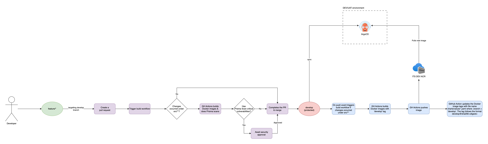
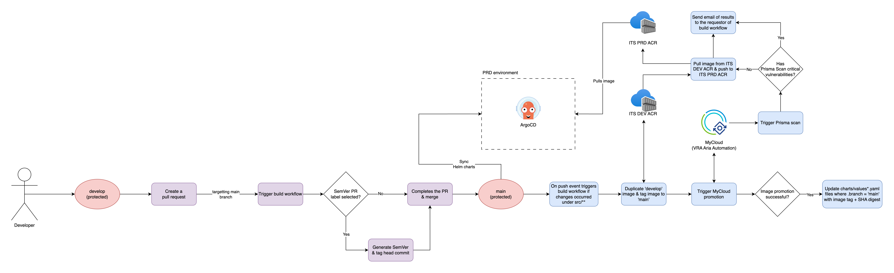

# librechat
TODO: Give a short introduction of your project. Let this section explain the objectives or the motivation behind this project. 

## 🔧 Setup & Installation
TODO: Describe how to install and setup your project.
```bash
cd TODO
```

## 🚀 Build & Test
TODO: Describe and show how to build your code and run the tests.

## 📁 Project Structure
```
├── /.github
│     ├── /workflows
│     │     ├── build-and-promote.yml
│     │     ├── codeql.yml
│     │     ├── dependency-review.yml
│     │     ├── prisma-scan.yml
│     │     └── ...
│     ├── CODEOWNERS
│     └── dependabot.yml
├── /charts
│     └── ...
├── /docs
│     ├── /images
│     │     └── ...
│     └── ...
├── /src
│     ├── /api
│     │     └── ...
│     ├── /data-migration
│     │     └── ...
│     └── /frontend
│           └── ...
├── .dockerignore
├── .gitignore
├── catalog-info.yaml
├── ...
└── README.md
```

## 🖊️ Contribute
TODO: Explain how other users and developers can contribute to make your code better.

## 🛠️ CI/CD Workflow

The CI/CD workflow is designed to automate the build, test, and deployment processes for our project. Here’s an overview of the key components and steps involved:

### 1\. Development Workflow (Feature Branch to DEV/UAT Environment)



-   **Feature Branch Workflow**:
    -   Developers commit code changes to their feature branches.
-   **PR: Docker Image Build and Prisma Image Scan**:
    -   If changes are made within the `src` folder the workflow builds Docker images against the source branch of the pull request.
    -   Prisma Image scan is triggered against the Docker images and provides summary output of results.
    -   If critical vulnerabilities were discovered by the Prisma Image scan, the GitHub Actions workflow will request Security approval/exemption from the ITS Security team, and the build workflow is paused.
    -   If there are no critical vulnerabilities or Security has approved the workflow, PR can be merged.
-   **Push with changes under src/: Docker Image Build, Push to ITS DEV ACR and Helm chart update**
    -   The workflow builds Docker images against `develop` branch, with `develop` tag.
    -   The image is pushed to ITS DEV ACR.
    -   The image SHA digest is retrieved from ITS DEV ACR.
    -   The GitHub Actions workflow searches any Helm values file(s) where key `.branch` equals `develop`, and updates to the tag `develop` + SHA digest (format: `develop@sha256:<digest>`).
-   **Automated Deployment to DEV**:
    -   Upon merging, **ArgoCD** detects changes in the `develop` branch and pulls the updated Docker image from the DEV ACR to deploy to the DEV/UAT environment.

### 2\. Production Workflow (Develop to Main Branch)



-   **PR: Merge develop code to main branch**:
    -   (Optional) Developers can select a pull request label (e.g., `patch`, `minor`, or `major`) to determine the type of version increment.
    -   If a SemVer PR label is selected then the build workflow generates a semantic version based on the selected PR label.
    -   For example, if the PR label is `patch`, the workflow will increment the patch number of the latest Git tag.
-   **Push with changes under src/: Docker Image re-tag, Promote image to ITS PRD ACR and Helm chart update**
    -   The workflow pulls the Docker image with `develop` tag.
    -   The pulled Docker image is tagged to `main`.
    -   The image with `main` tag is pushed to ITS DEV ACR.
    -   MyCloud image promotion workflow is triggered.
        -   MyCloud workflow pulls the image from ITS DEV ACR.
        -   Prisma scan is done against the image.
        -   If there are no critical vulnerabilities, image promotion to ITS PROD ACR is executed and the image SHA digest is copied over.
        -   If there are critical vulnerabilities, image promotion is cancelled and workflow returns error.
        -   The results of the MyCloud workflow is sent to the requestor of the build workflow.
    -   The image SHA digest is retrieved from ITS DEV ACR.
    -   The GitHub Actions workflow searches any Helm values file(s) where key `.branch` equals `main`, and updates to the tag `main` + SHA digest (format: `main@sha256:<digest>`).
-   **Automated Deployment to PROD**:
    -   **ArgoCD** detects changes in the `main` branch and automatically pulls the new Docker image from the PROD ACR for deployment to the production environment.