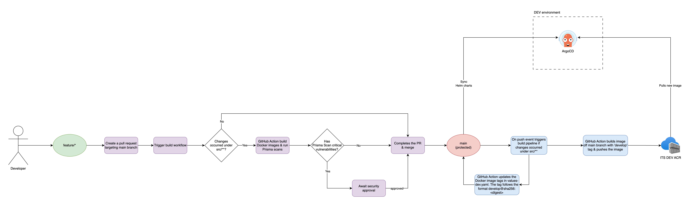
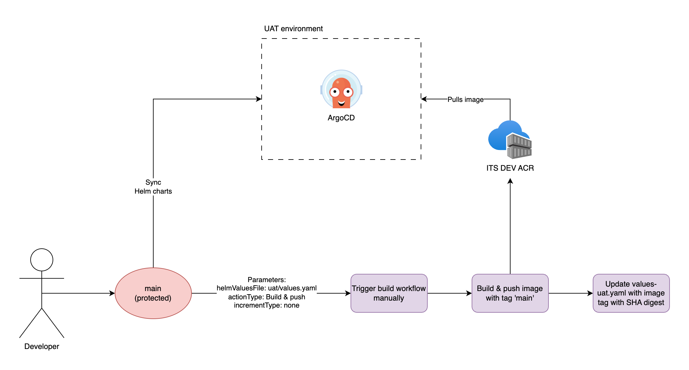
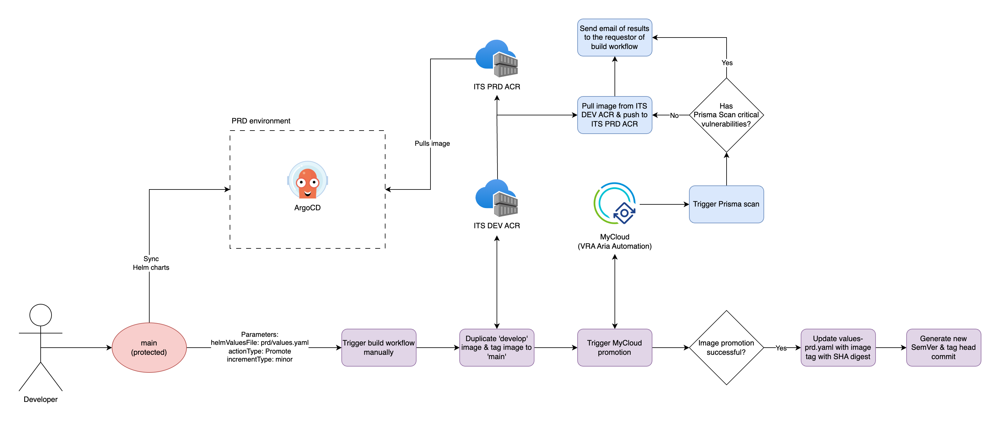

# ct-repo-dotnet-react-template
TODO: Give a short introduction of your project. Let this section explain the objectives or the motivation behind this project. 

## 🔧 Setup & Installation
TODO: Describe how to install and setup your project.
```bash
cd TODO
```

## 🚀 Build & Test
TODO: Describe and show how to build your code and run the tests.

## 📁 Project Structure
```
├── /.github
│     ├── /workflows
│     │     ├── build-and-promote.yml
│     │     ├── codeql.yml
│     │     ├── dependency-review.yml
│     │     ├── prisma-scan.yml
│     │     └── ...
│     ├── CODEOWNERS
│     └── dependabot.yml
├── /charts
│     └── ...
├── /docs
│     ├── /images
│     │     └── ...
│     └── ...
├── /src
│     ├── /api
│     │     └── ...
│     ├── /data-migration
│     │     └── ...
│     └── /frontend
│           └── ...
├── .dockerignore
├── .gitignore
├── catalog-info.yaml
├── ...
└── README.md
```

## 🖊️ Contribute
TODO: Explain how other users and developers can contribute to make your code better.

## 🛠️ CI/CD Workflow

### 1\. Development Workflow (Feature Branch to DEV environment)



-   **Feature Branch Workflow**:
    -   Developers commit code changes to their feature branches.
-   **Build Trigger**:
    -   The build workflow is triggered when the pull request is created or new commits are pushed/added to `main` branch.
-   **PR: Docker Image Build and Prisma Image Scan**:
    -   If changes are made within the `src` folder the workflow builds Docker images against the source branch of the pull request.
    -   Prisma Image scan is triggered against the Docker images and provides summary output of results.
    -   If critical vulnerabilities were discovered by the Prisma Image scan, the GitHub Actions workflow will request Security approval/exemption from the ITS Security team, and the build workflow is paused.
    -   If there are no critical vulnerabilities or Security has approved the workflow, PR can be merged.
-   **Push: Docker Image Build, Push to ITS DEV ACR and Helm chart update**
    -   The workflow builds Docker images against `main` branch, with `develop` tag.
    -   The image is pushed to ITS DEV ACR.
    -   The image SHA digest is retrieved from ITS DEV ACR.
    -   The GitHub Actions workflow updates the DEV Helm values file with the `develop` tag and SHA digest (format: `develop@sha256:<digest>`).
-   **Automated Deployment to DEV**:
    -   **ArgoCD** detects changes in the `main` branch and pulls the updated Docker image from the ITS DEV ACR to deploy to the DEV environment.

### 2\. Example: UAT Workflow (DEV to UAT environment)



-   **Manual Build Trigger**:
    -   The build workflow is triggered manually by the developer with the below parameters:
        -   '(Environment) Helm values file to target': `values-uat.yaml`
        -   'Action type': `Build & push`
        -   (Semver - Git only) Increment type': `none`
-   **Docker Image Build, Push to ITS DEV ACR and Helm chart update**
    -   The workflow builds Docker images against `main` branch, with `main` tag.
    -   The image is pushed to ITS DEV ACR.
    -   The image SHA digest is retrieved from ITS DEV ACR.
    -   The GitHub Actions workflow updates the UAT Helm values file with the `main` tag and SHA digest (format: `main@sha256:<digest>`).
-   **Automated Deployment to UAT**:
    -   **ArgoCD** detects changes in the `main` branch and pulls the updated Docker image from the ITS DEV ACR to deploy to the UAT environment.

### 3\. Example: Production Workflow (UAT to PRD environment)


-   **Manual Build Trigger**:
    -   The build workflow is triggered manually by the developer with the below parameters:
        -   '(Environment) Helm values file to target': `values-prd.yaml`
        -   'Action type': `Promote`
        -   (Semver - Git only) Increment type': `minor`
-   **Docker Image retag, Push to ITS DEV ACR, image promotion to ITS PRD ACR and Helm chart update**
    -   The workflow pulls the Docker image  with `develop` tag and retags the image to `main`.
    -   The image with tag `main` is pushed to ITS DEV ACR.
    -   MyCloud image promotion workflow is triggered.
        -   MyCloud workflow pulls the image from ITS DEV ACR.
        -   Prisma scan is done against the image.
        -   If there are no critical vulnerabilities, image promotion to ITS PROD ACR is executed and the image SHA digest is copied over.
        -   If there are critical vulnerabilities, image promotion is cancelled and workflow returns error.
        -   The results of the MyCloud workflow is sent to the requestor of the build workflow.
    -   The image SHA digest is retrieved from ITS DEV ACR (no need to retrieve SHA digest from ITS PRD ACR as it is the same).
    -   The GitHub Actions workflow updates the PRD Helm values file with the `main` tag and SHA digest (format: `main@sha256:<digest>`).
-   **Automated Deployment to PRD**:
    -   **ArgoCD** detects changes in the `main` branch and pulls the updated Docker image from the ITS DEV ACR to deploy to the PRD environment.

### (Manual trigger) Build workflow parameters

When triggering the build workflow manually there are three required parameters:
-   `helmValuesFile`: '(Environment) Helm values file to target'
-   `actionType`: 'Action type'
-   `incrementType`: '(Semver - Git only) Increment type'

The parameter values selected from `helmValuesFile` and `actionType` determine certain conditional steps. Those conditional steps can be explained with the below matrix:

Matrix Table: `actionType x helmValuesFile`
-   🟢 Build image
-   ⚪️ Push image to ITS DEV ACR
-   🟡 Duplicate image with `develop` tag in ITS DEV ACR to `main` image tag
-   🔵 Promote image to ITS PRD ACR via MyCloud
-   ⚫️ Update corresponding Helm values file with image tag + SHA digest

|  | values-dev.yaml | values-uat.yaml | values-prd.yaml |
| -------- | -------- | ------- | ------- |
| **Build & push** | 🟢 with `develop` image tag, ⚪️, ⚫️ | 🟢 with `main` image tag, ⚪️, ⚫️ | 🟢 with `main` image tag, ⚪️, ⚫️ |
| **Promote** | 🔵 with `develop` image tag, ⚫️ | 🟡, 🔵 with `main` image tag, ⚫️ | 🟡, 🔵 with `main` image tag, ⚫️ |
| **Build, push & promote** | 🟢 with `develop` image tag, ⚪️, 🔵 with `develop` image tag, ⚫️ | 🟢 with `main` image tag, ⚪️, 🟡, 🔵 with `main` image tag, ⚫️ | 🟢 with `main` image tag, ⚪️, 🟡, 🔵 with `main` image tag, ⚫️ |


The parameter value selected from `incrementType` affects the above matrix irrespective of the values selected for `helmValuesFile` and `actionType`. E.g. If a developer selects a value other than `none` for `incrementType`, a step to generate and Git tag the target branch with semantic version is added after any of the steps from the above matrix is completed.