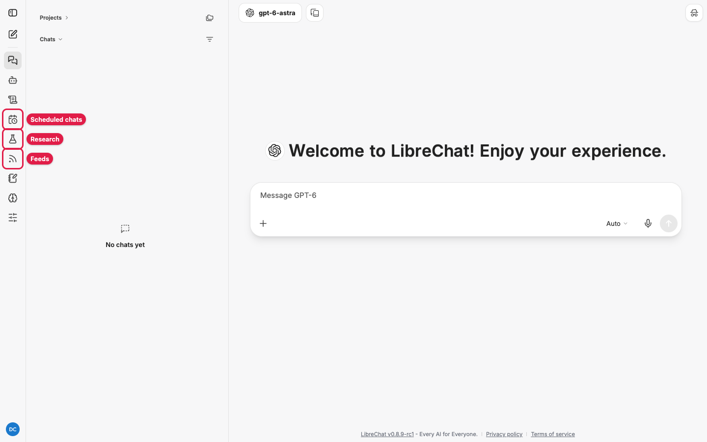
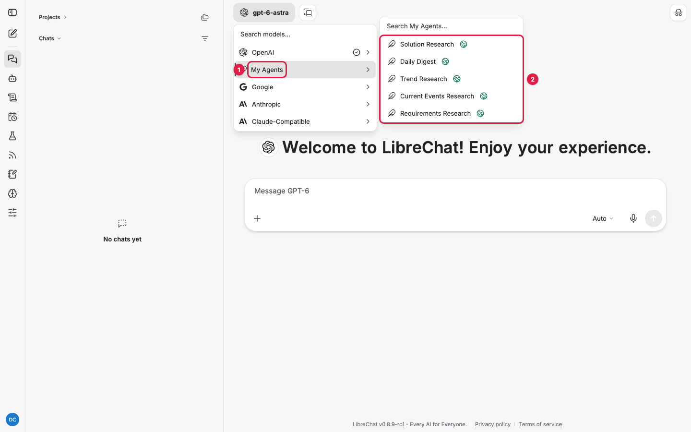
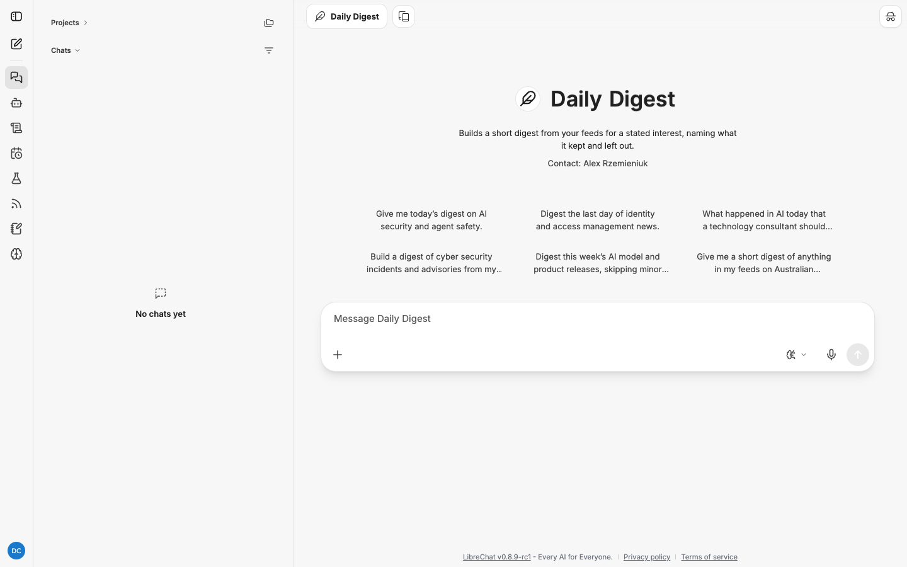

# Research agents: how-to guides

LibreChat's research agents take a question, research it on their own in phases, and deliver
a report in which every factual sentence cites a source the agent actually read during the
run. These guides show you how to use them, step by step, with screenshots from a running
instance.

The design behind the feature is in [research-agent-design.md](../research-agent-design.md)
and the build checklist in [research-agent-todo.md](../research-agent-todo.md). You do not
need either to use the agents.

## Which guide do I need?

| I want to... | Read |
|---|---|
| Run my first research job | [Quick start](#quick-start) below, then [research-agents.md](research-agents.md) |
| Understand a report, the Research panel, budgets and errors | [research-agents.md](research-agents.md) |
| Add, organise and check the feeds the agents read | [feeds.md](feeds.md) |
| Get a report every morning or every week without asking | [scheduling.md](scheduling.md) |
| Ask what a standard, policy or client specification requires | [requirements-research.md](requirements-research.md) |
| Catch up on what is happening now on a topic | [current-events-research.md](current-events-research.md) |
| Track how a topic changes over weeks and months | [trend-research.md](trend-research.md) |
| Filter my feeds down to one interest, daily | [daily-digest.md](daily-digest.md) |
| Get options and a recommendation for a client problem | [solution-research.md](solution-research.md) |
| Turn the feature on, tune it, curate the feed catalogue | [administration.md](administration.md) |

## The five agents at a glance

| Agent | Answers | Reads | Can be scheduled | Default budget |
|---|---|---|---|---|
| Requirements Research | "What does this document actually require?" | Documents you name, attachments, web if needed | No | 45 min, 400 steps |
| Current Events Research | "What is happening now?" | Web search, your feeds | Yes | 30 min, 300 steps |
| Trend Research | "How is this changing over time?" | Web, feeds, its own earlier reports | Yes | 30 min, 300 steps |
| Daily Digest | "What in my feeds matters to this interest?" | Your feeds first, web to fill gaps | Yes, normally | 15 min, 200 steps |
| Solution Research | "What should the client do?" | Web, vendor docs, documents you name, attachments | No | 60 min, 500 steps |

## Quick start

This takes about ten minutes, most of it waiting for the job.

1. **Check research is switched on.** The left-hand rail shows a flask icon (**Research**)
   and an RSS icon (**Feeds**). A calendar-with-clock icon (**Scheduled chats**) above them
   means scheduling is on too. If you cannot see Research and Feeds, ask your administrator;
   see [administration.md](administration.md).

   

2. **Pick a research agent.** Click the model name at the top of a new chat, hover
   **My Agents**, and choose one of the five research agents.

   

3. **Send a request.** Click one of the six conversation starters or type your own question,
   then send. Each starter is a complete request.

   

4. **Watch it run.** Open the **Research** panel from the rail to follow the job's phase and
   step count. The brief appears in the conversation within seconds.

5. **Read the report.** When the job reaches **Delivered**, the conversation gets a message
   with the verification counts and a **Download the report** link. The report is a markdown
   file.

The first job you send while your **Feeds** list is empty works fine for every agent except
the Daily Digest, which needs feeds. Import some first; see [feeds.md](feeds.md).

## Direct links to each agent

Each agent has a fixed id, so you can bookmark a new chat with it already selected:

| Agent | Link (relative to your LibreChat address) |
|---|---|
| Requirements Research | `/c/new?agent_id=agent_research_requirements` |
| Current Events Research | `/c/new?agent_id=agent_research_current_events` |
| Trend Research | `/c/new?agent_id=agent_research_trends` |
| Daily Digest | `/c/new?agent_id=agent_research_digest` |
| Solution Research | `/c/new?agent_id=agent_research_solution` |

## Known issues

Observed on 3 November 2026 while capturing these guides. Each has a workaround; remove the
line once it is fixed.

| What you see | Workaround |
|---|---|
| Dollar signs and brackets in the report file appear as `&#36;`, `&#91;` and similar | By design: characters from web pages are escaped so they cannot open links, maths or code in LibreChat. Any markdown viewer shows them normally |
| Phase prompts such as "[Research phase] Brief: ..." appear in the conversation under your name | They are the job's own instructions to each phase, not something you sent. Ignore them |
