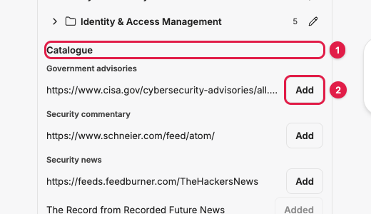

# Research agents: administration

For LibreChat administrators: how to switch research on, connect what it needs, curate the
feed catalogue, and tune it. Everything is set in `librechat.yaml` unless it says otherwise,
and every change to that file needs a backend restart.

## Contents

- [Switch research on](#switch-research-on)
- [Switch on scheduling](#switch-on-scheduling)
- [Set up email delivery](#set-up-email-delivery)
- [Connect SharePoint and OneDrive](#connect-sharepoint-and-onedrive)
- [Curate the feed catalogue](#curate-the-feed-catalogue)
- [Re-enable a paused feed](#re-enable-a-paused-feed)
- [Manage the research agents](#manage-the-research-agents)
- [Configuration reference](#configuration-reference)
- [Operations](#operations)
- [Switch research off](#switch-research-off)

## Switch research on

1. Get a [Brave Search API](https://brave.com/search/api/) key and put it in `.env`:

   ```bash
   BRAVE_API_KEY=your-key
   ```

2. Add a `research` section to `librechat.yaml`. `provider` is the name of an endpoint you
   already have configured, as it appears in the model picker; `model` is a model on that
   endpoint.

   ```yaml
   research:
     enabled: true
     agents:
       provider: 'Claude-Compatible'
       model: 'claude-sonnet-4-5'
     verification:
       model: 'claude-sonnet-4-5'   # optional; defaults to agents.model, on the same endpoint
     search:
       braveApiKey: '${BRAVE_API_KEY}'
   ```

3. Restart the backend.
4. Check the log for the seeding line, and that users with agent access now see **Research**
   and **Feeds** on the rail.

On start, the backend creates the five research agents if they are missing, in a
**Research** category, viewable by everyone. Their author is `research.agents.author` (a user
id) or, if unset, the first admin user. Seeding is skipped, with a warning in the log, when
`agents.provider` or `agents.model` is missing ("research.agents.provider and model are
required to seed research agents") or there is no admin and no author ("No author for
research agents").

Users need the agents permission to see the Research and Feeds panels.

## Switch on scheduling

Scheduled research rides on LibreChat's scheduled chats, which are experimental and off by
default. Two things are needed.

1. **Enable the interface** in `librechat.yaml`:

   ```yaml
   interface:
     schedules:
       use: true
       create: true
       maxPerUser: 10
       minIntervalMinutes: 60
       autoDisableAfterFailures: 5
   ```

   The USER and ADMIN roles already have the schedules permission by default. This adds
   **Scheduled chats** to the rail.

2. **Let the scheduler arm.** The scheduler refuses to start unless it can be sure no other
   replica is running jobs it cannot see. Either:

   - run a shared stream store: set `USE_REDIS_STREAMS` with Redis configured, or
   - assert a single replica: add `SCHEDULES_SINGLE_PROCESS=true` to `.env`.

   Only use `SCHEDULES_SINGLE_PROCESS` when exactly one API process runs.

3. Restart the backend and check the log. If the scheduler did not arm you will see:

   ```
   error: [schedules] scheduler NOT started: this process cannot see other replicas' generations. ...
   error: [schedules] write routes are PERMANENTLY unavailable in this process: the engine did not arm.
   ```

   In that state the rail still shows **Scheduled chats**, but **Create** fails with a red
   "Error" message and `POST /api/schedules` returns `503 SCHEDULES_UNAVAILABLE`.

Only Current Events, Trend Research and Daily Digest can run on a schedule. A schedule using
Requirements or Solution Research is accepted by the dialog, but every run is refused with
"This research job cannot run on a schedule." until the schedule auto-disables.

## Set up email delivery

1. Configure LibreChat's normal email service (`EMAIL_SERVICE` or SMTP settings, or Mailgun)
   in `.env`, as for password resets. When it works, the public config reports
   `emailEnabled: true`.
2. Leave `research.delivery.email` at its default of `true`.
3. Make sure users verify their email address. Reports are never emailed to an unverified
   address.

Users then see **Also send each report by email** for each research schedule in the Research
panel. Without an email service they see "Each run's report arrives in a new conversation."

The email body is the report rendered to HTML (raw HTML escaped, unsafe links dropped) with a
link to the conversation. A failed send is retried up to `delivery.maxAttempts` times (5),
starting `delivery.retryBaseSeconds` (60) apart and doubling, without re-running the job.

## Connect SharePoint and OneDrive

Requirements and Solution Research read internal documents through an MCP server, normally a
gateway that performs on-behalf-of token exchange with the user's OpenID token.

```yaml
research:
  documents:
    mcpServer: 'document-gateway'   # an MCP server name from mcpServers
    toolName: 'get_document'        # the tool that returns one document
    argumentName: 'reference'       # the tool argument that receives the path or URL
```

The tool is called once per named document, during the brief, while the user's request is
live. Users name documents as URLs or `sharepoint:/...` and `onedrive:/...` paths; only names
in the submitted message can be read. Limits: `submitFetch.maxDocuments` (25) and
`submitFetch.maxMinutes` (10).

Without this section, the agents still read attachments and the web, and a named internal
document gives the user "Document access is not configured." in the tool result.

Reading documents in scheduled runs, mid-run discovery and Teams delivery all wait on a
gateway token provider that is not built yet (design section 5.9, todo phase 4).

## Curate the feed catalogue

The catalogue is the list of feeds offered to every user at the bottom of the Feeds panel,
grouped by category. There is no admin screen for it yet; manage it through the API with an
admin account.

The quickest way is the browser console while signed in to LibreChat as an admin. Open the
developer tools (F12), go to **Console**, and paste:

```js
const { token } = await fetch('/api/auth/refresh', { method: 'POST', credentials: 'include' }).then((r) => r.json());
const api = (path, method = 'GET', body) =>
  fetch(`/api/research/feeds${path}`, {
    method,
    headers: { Authorization: `Bearer ${token}`, 'Content-Type': 'application/json' },
    body: body ? JSON.stringify(body) : undefined,
  }).then((r) => r.json());
```

Then:

| Task | Command |
|---|---|
| List the catalogue | `await api('/catalogue')` |
| Add a feed under a category | `await api('/catalogue', 'POST', { url: 'https://www.cisa.gov/cybersecurity-advisories/all.xml', category: 'Government advisories' })` |
| Move a feed to another category | `await api('/catalogue/FEED_ID', 'PATCH', { category: 'Security news' })` |
| Take a feed out of the catalogue | `await api('/catalogue/FEED_ID', 'PATCH', { catalogue: false })` |

`FEED_ID` is the `id` field (it starts `feed_`) from the list or from the add response.
Adding is idempotent: a feed already known to LibreChat is flagged rather than duplicated.
Taking a feed out of the catalogue leaves existing subscriptions alone.

A new catalogue feed shows its URL in the panel until the poller has checked it, within
`feeds.pollIntervalMinutes` (30). Users who add it get it in a folder named after its
category.



Non-admins get `403` from the POST and PATCH routes.

## Re-enable a paused feed

A feed that fails `feeds.disableAfterFailures` (10) checks in a row is paused for everyone
who follows it, and users see "Paused after repeated failures." Subscriptions are kept. Once
the source works again, with the console helper above:

```js
await api('/catalogue/FEED_ID', 'PATCH', { disabled: false });
```

This works for any feed, not only catalogue feeds. Get the id from `await api('')`, which
lists the signed-in user's subscriptions; each has a `feedId`.

## Manage the research agents

- **Editing.** Open an agent in the Agent Builder and change its instructions, description
  or conversation starters. Edits are kept across restarts: seeding only creates missing
  agents. Provider and model come from `research.agents`.
- **Deleting.** Refused while `research.enabled` is true, with "This research agent is
  managed by the system and cannot be deleted while research is enabled." (HTTP 409,
  `research_agent_protected`). Jobs and schedules refer to the agents by fixed id.
- **Restoring.** If an agent is missing, restart the backend. It is recreated with the
  shipped instructions and starters; earlier edits are not recovered.
- **Fixed ids:** `agent_research_requirements`, `agent_research_current_events`,
  `agent_research_trends`, `agent_research_digest`, `agent_research_solution`.
- **Do not add the generic web search or file search capabilities** to these agents. They
  carry their own source tools so that every source becomes a snapshot the verifier can
  re-open.

## Configuration reference

Every value below is optional; the default reproduces the designed behaviour.

| Key | Default | What it controls |
|---|---|---|
| `enabled` | `false` | The whole feature, including the panels and agent seeding |
| `agents.provider` | none (required) | Endpoint the agents and the verifier run on |
| `agents.model` | none (required) | Model for the agents |
| `agents.author` | first admin | User id that owns the seeded agents |
| `search.braveApiKey` | `${BRAVE_API_KEY}` | Brave Search key for `search_web` |
| `search.count` | `10` | Results per search (1 to 20) |
| `fetch.maxBytes` | `5000000` | Largest page fetched |
| `fetch.timeoutSeconds` | `20` | Page fetch timeout |
| `fetch.maxRedirects` | `5` | Redirects followed (0 to 10) |
| `fetch.allowedAddresses` | none | `host:port` pairs exempt from the SSRF guard |
| `documents.mcpServer` | none | MCP server for SharePoint and OneDrive |
| `documents.toolName` | none | Tool on that server that returns a document |
| `documents.argumentName` | `reference` | Tool argument for the path or URL |
| `submitFetch.maxDocuments` | `25` | Documents read per job |
| `submitFetch.maxMinutes` | `10` | Time allowed to read them |
| `jobs.requirements` | 45 min, 400 steps | `wallClockMinutes`, `maxSteps` |
| `jobs.currentEvents` | 30 min, 300 steps | `wallClockMinutes`, `maxSteps` |
| `jobs.trends` | 30 min, 300 steps | plus `priorReports` (3, max 20) |
| `jobs.digest` | 15 min, 200 steps | plus `maxItems` (200) |
| `jobs.solution` | 60 min, 500 steps | `wallClockMinutes`, `maxSteps` |
| `budgetDraftThreshold` | `0.85` | Fraction of the wall clock after which research stops and drafting starts |
| `maxConcurrentJobsPerUser` | `2` | Running jobs per user; more are refused |
| `verification.model` | `agents.model` | Model that checks each citation |
| `verification.maxClaims` | `400` | Citations checked per report |
| `verification.maxAttempts` | `5` | Checking or delivery attempts before the job fails |
| `snapshots.retentionDays` | `45` | Age at which uncited snapshots are swept |
| `snapshots.sweepHour` | `3` | Hour of the nightly sweep (server time) |
| `feeds.pollIntervalMinutes` | `30` | How often each feed is checked |
| `feeds.maxPerUser` | `100` | Feeds per user |
| `feeds.disableAfterFailures` | `10` | Consecutive failures before a feed is paused |
| `delivery.email` | `true` | Offer email delivery when an email service exists |
| `delivery.teams` | `false` | Reserved for Teams delivery (not built) |
| `delivery.maxAttempts` | `5` | Send attempts per extra channel |
| `delivery.retryBaseSeconds` | `60` | First retry delay; doubles each time, capped at a day |

All keys sit under `research:`. Schedule limits (per-user cap, minimum interval,
auto-disable) belong to `interface.schedules`, not here.

## Operations

- **Background worker.** Every 15 seconds the backend supervises phases, stops jobs at the
  draft threshold, forces delivery of jobs past their deadline, runs citation checks and
  sends extra deliveries.
- **Restarts.** A restart in the middle of a phase interrupts that turn. The job then waits
  until its wall-clock deadline and delivers what it has as a partial report. Avoid
  restarting while long Solution jobs are running.
- **Feed poller.** Runs beside the scheduler, one poll per feed however many users follow it,
  honouring ETag and Last-Modified.
- **Snapshot sweep.** Nightly at `snapshots.sweepHour`, on one replica. Snapshots dominate
  storage growth; watch the sweep's log lines.
- **Logs.** Research lines are prefixed `[research]`, scheduler lines `[schedules]`.
- **Auth cache.** If you change a user's role in the database directly (for example to make
  them an admin for catalogue work), the change can take a short while to apply because
  signed-in users are briefly cached. Reloading or signing in again picks it up.

## Switch research off

Set `research.enabled: false` and restart. The panels disappear, no new jobs start, and the
delete guard on the five agents lifts so you can remove them. Existing reports stay in users'
conversations.
