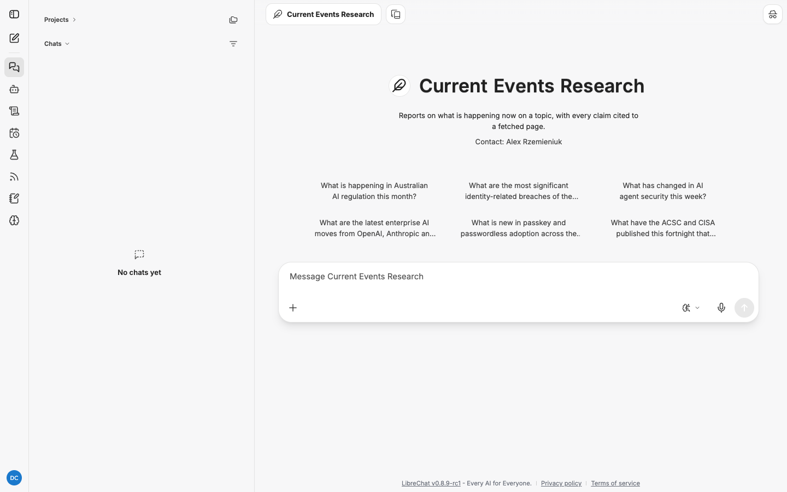

# Current Events Research: how to use it

Current Events Research tells you what is happening now on a topic, with every claim cited
to a page the agent fetched. It is the agent for "catch me up on X" and "what happened this
fortnight in Y".

| | |
|---|---|
| Reads | Web search and fetched pages, plus your feeds if you have them |
| Schedulable | Yes |
| Default budget | 30 minutes, 300 steps |
| Direct link | `/c/new?agent_id=agent_research_current_events` |

Read [research-agents.md](research-agents.md) first for how jobs run and how to read a report.

## When to use it

- Preparing for a client meeting on a topic that moves quickly.
- A dated account of a breach, an incident or a regulatory announcement.
- Who is doing what in a market right now.
- A weekly "what to watch" for a practice area.

Do not use it for how a topic has changed over months. That is
[Trend Research](trend-research.md). Do not use it to filter your feeds to an interest. That
is [Daily Digest](daily-digest.md).

## Run one, step by step

1. Start a new chat, click the model name, hover **My Agents** and choose
   **Current Events Research**.

   

2. Click a starter, or type your own request with a time window (see the tips below) and
   send.
3. Open the **Research** panel to follow it. Most runs finish well inside the 30 minutes.
4. Read the brief when it appears. Check the window in **Question** and the **Exclusions**.
   Cancel and resubmit if either is wrong.
5. When the panel says **Delivered**, click **Download the report** in the conversation.

### The six starters

| Starter |
|---|
| What is happening in Australian AI regulation this month? |
| What are the most significant identity-related breaches of the past two weeks? |
| What has changed in AI agent security this week? |
| What are the latest enterprise AI moves from OpenAI, Anthropic and Google? |
| What is new in passkey and passwordless adoption across the major platforms? |
| What have the ACSC and CISA published this fortnight that security teams should act on? |

Every starter carries its own window ("this month", "the past two weeks"). Keep one in your
own requests too.

## The report template

```
## Summary
## What is happening (dated, most recent first)
## Who is involved
## What to watch next
```

## A real run: what an interrupted job delivers

The run captured for these guides used the starter "What has changed in AI agent security
this week?". The server was restarted three times while it was researching, so its drafting
turn was lost. The job then waited until its 30-minute deadline and delivered what it had
gathered as a **Partial report**: 81 citations from 83 recorded findings, five subagents (one
of which failed).

Because no draft existed, the report is the deterministic fallback: a flat **Findings** list
of every recorded claim with its citation, instead of the Summary / What is happening / Who
is involved / What to watch next template. Trimmed:

```markdown
> **Verification:** 69 supported, 12 unverified, 0 source unavailable (81 citations). 19 sentences carry no citation.
>
> **Partial report:** the research budget ran out before the job finished, so this report covers only what was gathered in time.

## Findings

- Chinese hackers used ARTEX, an open-source multi-agent AI penetration-testing framework, in
  attacks against more than 200 organizations across 14 countries beginning on October 17,
  2026. [1]
- The Dutch Institute for Vulnerability Disclosure (DIVD) suffered an AI agent attack in
  September 2026 using ARTEX AI, which went from initial access to root privileges in 12
  minutes [...] [1]
```

What to notice:

- **Every line is still cited and checked.** A fallback report is raw, not unverified.
- **Expect near-duplicates.** Several subagents fetched the same article, so the same fact
  appears more than once, each citing its own snapshot of the page.
- **Read the Scope notes.** They name what the report misses from the brief or adds beyond
  it, so you know what a resubmission should ask for.
- **Resubmit for a proper report.** The findings are a usable starting point, but the
  template sections only appear when drafting runs.

## Worked examples

The briefs and report extracts below are illustrative: they show the shape you get back,
not a recorded run. Citation numbers stand for entries in the report's **Sources** list.

### Example 1: a dated catch-up

**You send** (the third starter, with two extra instructions):

```
What has changed in AI agent security this week? Cover new attack techniques, vendor
responses and any guidance from government agencies. Date every item. Skip opinion pieces.
```

**The brief:**

```
## Question
Developments in the security of AI agents during the past seven days: attack techniques,
vendor mitigations and government guidance.

## Sources
Web search for discovery, then fetched pages. Feed items from the user's subscriptions
published in the past seven days where relevant.

## Output
Current events report: Summary; What is happening, dated, most recent first; Who is
involved; What to watch next.

## Exclusions
Opinion and commentary pieces. Items older than seven days except for context.
```

**The report** opens:

```
> **Verification:** 27 supported, 2 unverified, 0 source unavailable (29 citations). 0 sentences carry no citation.

## Summary
The week's notable developments were a disclosed prompt-injection chain against a widely
used coding agent, two vendors shipping tool-call allow-listing, and an updated advisory on
securing agentic systems [1] [2] [3].

## What is happening
- **2 November.** The agency published updated guidance recommending that agent tool
  permissions be scoped per task rather than per agent [3].
- **31 October.** A researcher disclosed ... [1].
```

Dates are the agent's reading of the source's own date. When a source carries no date, the
agent says so rather than guessing.

### Example 2: a narrow, named subject

```
What are the most significant identity-related breaches of the past two weeks? For each:
who was hit, what was taken, how the attackers got in, and what the victim has said
publicly. Australian incidents first, then global.
```

The brief shows Exclusions as "Breaches with no identity component" and the report orders
Australian incidents first as asked. Expect some **[Unverified]** marks on the "how the
attackers got in" claims. Early reporting is often speculative and the verifier is strict.

### Example 3: using your feeds

If your Feeds panel has a folder of security news, say so:

```
What have the ACSC and CISA published this fortnight that security teams should act on?
Use my feeds as the first source and only go to the web for detail.
```

The agent reads items from your subscriptions published in the window, then fetches the
pages behind them for detail. Feed sources in the report link to the item and show when it
was fetched.

## Scheduling it

A weekly current events run is a good practice-area briefing. Full walkthrough:
[scheduling.md](scheduling.md).

1. Open **Scheduled chats** on the rail and click **New schedule**.
2. **Agent**: Current Events Research.
3. **Prompt**, for example:

   ```
   What happened in Australian AI regulation this week? Cover government announcements,
   consultations, and statements from the OAIC, ACCC and eSafety. Date every item.
   ```

4. **Frequency**: Weekly, Monday, 07:00. Check the **Time zone**.
5. Click **Create**. For email as well, switch on **Also send each report by email** under
   **Scheduled research** in the Research panel, if it is offered.

Each run creates a new conversation. Scheduled runs read the web and your feeds only.

## Tips

- **Always give a window.** "This week", "the past fortnight", "since 15 October". Without
  one, "now" is up to the agent.
- **Ask for dates.** The template dates items, but saying "date every item" makes the agent
  stricter about it.
- **Name the actors you care about.** "OpenAI, Anthropic and Google" beats "the big AI
  labs".
- **Expect unverified marks on breaking news.** The verifier checks that the cited passage
  supports the claim. Early articles hedge, so the verifier hedges too.
- **Say "skip opinion pieces"** if you want reporting, not commentary.

## Troubleshooting

| Symptom | Cause | Fix |
|---|---|---|
| Report is thin | Topic too narrow for the window, or search returned little | Widen the window or the topic |
| Items are old | No window given | Add one |
| Many **[Unverified]** sentences | Sources hedge or contradict each other | Normal for breaking news; read the citations |
| **Partial report** | 300 steps spent on a broad topic, or the job was interrupted | Narrow the topic, or ask your administrator to raise the budget |
| Feed items ignored | No feeds, or none in the window | Check the Feeds panel; import an OPML file or add from the catalogue |
| Job sits in **Drafting** for a long time | The server restarted mid-job | It delivers what it has when its 30-minute deadline passes. See [research-agents.md](research-agents.md#when-something-goes-wrong) |
