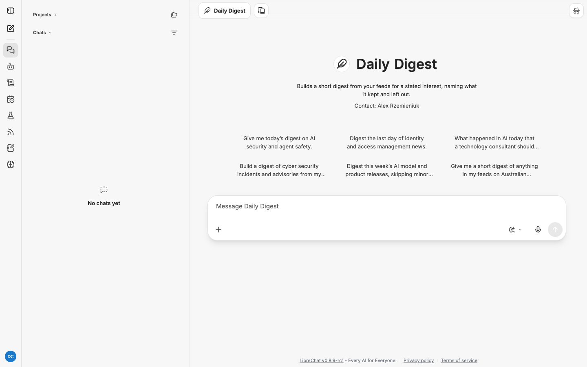
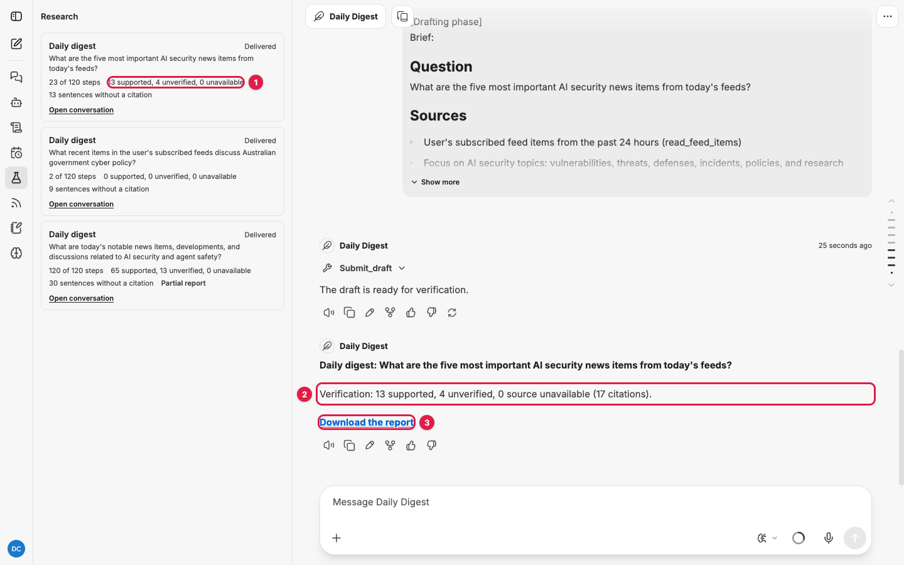

# Daily Digest: how to use it

Daily Digest reads your feeds, keeps what matches a stated interest, and tells you both what
it kept and what it left out. It is built to run every morning on a schedule.

| | |
|---|---|
| Reads | Your feeds first, the web only to fill gaps |
| Schedulable | Yes, and that is its normal mode |
| Default budget | 15 minutes, 200 steps |
| Feed items considered per run | Up to 200, most recent first |
| Direct link | `/c/new?agent_id=agent_research_digest` |

Read [research-agents.md](research-agents.md) first for how jobs run and how to read a report.

## When to use it

- A morning briefing from the sources you already follow.
- Cutting a noisy feed list down to one interest.
- Several digests on several interests from the same feed list.

A digest summarises items. It does not research a question. For that use
[Current Events Research](current-events-research.md).

## Step 1: set up your feeds

A digest with no feeds has nothing to digest. Before your first digest:

1. Open the **Feeds** panel (the RSS icon on the rail).
2. Click **Import** and choose an OPML file from your feed reader, or add feeds from the
   **Catalogue**.
3. Expand two or three feeds with the chevron to check they show recent items.

The full walkthrough, with screenshots, is in [feeds.md](feeds.md).

## Step 2: run a digest by hand

Do this once before you schedule anything, to see what the agent keeps and drops for your
interest.

1. Start a new chat, click the model name, hover **My Agents** and choose **Daily Digest**.
2. Click a starter, or type your interest statement (see below) and send.

   

3. Open the **Research** panel to follow it. A digest usually takes two to ten minutes.
4. Read the brief when it appears. Check that **Exclusions** says what you meant to leave
   out.
5. When the panel says **Delivered**, click **Download the report** in the conversation.



### The six starters

| Starter | Good for |
|---|---|
| Give me today's digest on AI security and agent safety. | AI security practitioners |
| Digest the last day of identity and access management news. | IAM teams |
| What happened in AI today that a technology consultant should know? | A broad daily AI briefing |
| Build a digest of cyber security incidents and advisories from my feeds. | Incident and advisory tracking |
| Digest this week's AI model and product releases, skipping minor updates. | A weekly release round-up |
| Give me a short digest of anything in my feeds on Australian government cyber policy. | Policy watchers |

The starters are short on purpose. Add your own keep and leave-out rules for a sharper digest.

## Write the interest statement

Write it as "Keep X. Leave out Y." The agent maps those straight onto the brief's Exclusions
and the report's two sections.

```
Give me today's digest on AI security and agent safety. Keep anything about attacks on or
through AI agents, model safety research with a security angle, and vendor security
features. Leave out general AI product news and funding announcements.
```

## The window

- **Scheduled digest**: items published since the schedule's last delivered run. A daily
  schedule therefore covers roughly the past day, and if a run fails the next one covers two
  days.
- **Digest from a chat**: items in the window you name, or the past day if you name none.

## The report

The template has two required sections:

```
## Kept       one bullet per item: title, why it matters to your interest, citation
## Left out   one bullet per dropped item and one line on why it was dropped
```

The **Left out** section is the point. You can see what the agent decided was noise and
disagree with it. If the draft forgets it, the heading is added with a note saying so.

### A real example

This is from an earlier run of the first starter against the 55 feeds in
[ai-cyber-iam-feeds.opml](../ai-cyber-iam-feeds.opml) (the screenshots show a later run of
the same starter). It took about six and a half minutes. Excerpts, trimmed:

```markdown
> **Verification:** 63 supported, 4 unverified, 0 source unavailable (67 citations). 54 sentences carry no citation.

## Kept

• **Chinese Hackers Deploy ARTEX AI Framework in Multi-Country Campaign**: Chinese hackers
  from the Vapor Panda threat group used ARTEX, an open-source multi-agent AI
  penetration-testing framework, in automated attacks against more than 200 organizations
  across 14 countries starting October 17, 2026 [...] [1]. This marks a significant
  escalation in real-world AI-powered cyberattacks [...]

## Left out

• **Google Dismantles 1.3 Million Device Android TV Botnet**: [...] [28]. While significant,
  this is a traditional IoT botnet operation without AI security or agent safety
  implications [...]

## Sources

1. [Chinese hackers use ARTEX AI in automated attacks against 200 orgs](https://www.bleepingcomputer.com/...),
   fetched 2026-11-03 (snapshot snap_aiHcnx3jLHEy)
28. [Tech Firms Dismantle Botnet That Turned 1.3M TV Boxes Into Proxies - Krebs on Security](https://krebsonsecurity.com/...),
   fetched 2026-11-03 (snapshot snap_4nk3p2_p8BZA)
```

What to notice:

- **Each Kept item ends with a line on why it matters.** That line is the agent's judgement
  against your interest, so it has no citation. That is why a digest's "sentences without a
  citation" count is high (54 here) while every factual sentence is cited.
- **Left out items still cite their source**, so you can open anything the agent dropped.
- **Sources mix feeds and web.** The feeds supplied Krebs, The Record and BleepingComputer
  items; the web filled gaps. Every source has a fetch date and snapshot id.
- **The starter was broad, so the digest was long.** 28 sources and about 30 KB. A tighter
  interest statement gives a shorter digest. Three kept items and twenty left out is a good
  day, not a thin one.

## Step 3: schedule it

This is the normal way to use the digest. The full walkthrough is in
[scheduling.md](scheduling.md); in short:

1. Open **Scheduled chats** on the rail and click **New schedule**.
2. **Name**: something you will recognise in the chat list, for example "Morning AI security
   digest".
3. **Agent**: Daily Digest.
4. **Prompt**: your interest statement.
5. **Frequency**: Daily. **Time**: early morning, for example 06:00. Check the **Time zone**.
6. Click **Create**. To test it now rather than tomorrow morning, open the schedule's **...**
   menu and choose **Run now**.
7. To get it by email as well, open the **Research** panel, find the schedule under
   **Scheduled research** and switch on **Also send each report by email** (only shown when
   your administrator has set up email).

Run several schedules for several interests. They share your feed list and run
independently. Each run creates a new conversation.

## Tips

- **Read Left out for a week.** If good items keep landing there, your interest statement is
  too narrow. If junk keeps landing in Kept, it is too broad.
- **Organise feeds into folders.** It does not change what the agent reads, but it makes it
  much easier to see which sources feed which digest.
- **200 items is the cap per run.** If your feeds produce more than that in a day, the agent
  takes the most recent 200. Trim the feed list or split interests across schedules.
- **Short is correct.** A digest with three kept items and twenty left out has done its job.

## Troubleshooting

| Symptom | Cause | Fix |
|---|---|---|
| The report says you have no feeds, or found no feed items | No feeds, feeds paused, or nothing published in the window | Check the Feeds panel; show recent items on a few feeds |
| Everything is kept | Interest statement too broad | Add explicit "Leave out" rules |
| Good items are left out | Interest statement too narrow | Loosen the "Keep" rules |
| The digest is very long | Broad interest and many feeds | Tighten the interest; split it across two schedules |
| Digest covers two days | The previous run failed | Check the Research panel; the next run resets the window |
| Email not received | Address not verified, or email not set up by the administrator | The conversation copy is complete; verify your address |
| **Partial report** | 200 steps used on a very large feed list | Trim feeds or split interests across schedules |
