# Feeds: how to set them up and keep them tidy

Feeds are the RSS and Atom sources the research agents read. The Daily Digest reads nothing
else first, so it needs them. Current Events and Trend Research use them as a second source
alongside web search. Requirements and Solution Research do not use them.

Everything here happens in the **Feeds** panel: the RSS icon on the rail.

## Contents

- [The Feeds panel at a glance](#the-feeds-panel-at-a-glance)
- [Import feeds from an OPML file](#import-feeds-from-an-opml-file)
- [Add feeds from the catalogue](#add-feeds-from-the-catalogue)
- [Check that a feed is working](#check-that-a-feed-is-working)
- [Organise feeds into folders](#organise-feeds-into-folders)
- [Rename a folder](#rename-a-folder)
- [Remove a feed](#remove-a-feed)
- [Export your feeds](#export-your-feeds)
- [Limits and housekeeping](#limits-and-housekeeping)
- [Troubleshooting](#troubleshooting)

## The Feeds panel at a glance

Open the panel from the RSS icon. With no feeds yet it shows **Import** and **Export**, a
short explanation, and the **Catalogue** if your administrator has curated one:

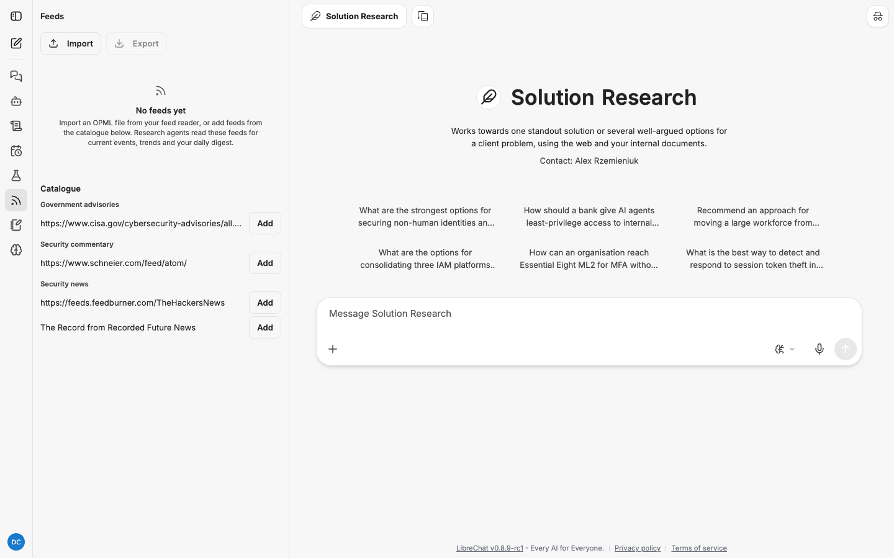

Once you have feeds, each folder is a collapsible header and each feed is a row:

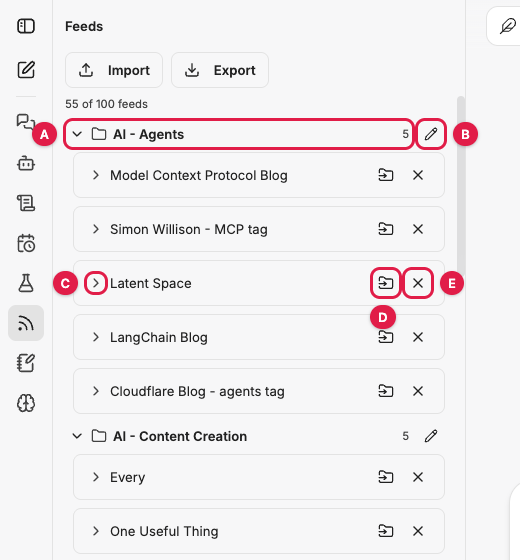

| Callout | Control | What it does |
|---|---|---|
| A | Folder header | Click to collapse or expand the folder. The number is how many feeds it holds |
| B | Pencil | Rename the folder |
| C | Chevron | Show the feed's items from the last 45 days |
| D | Folder-arrow icon | Move the feed to another folder |
| E | Cross | Remove the feed from your list |

The line under **Import** and **Export** shows how many feeds you follow against your limit,
for example "55 of 100 feeds". Feeds that are not in any folder are listed under
**Not in a folder**. The **Catalogue** section sits at the bottom, when your administrator has
curated one.

## Import feeds from an OPML file

OPML is the export format every feed reader supports (Feedly, Inoreader, NetNewsWire,
Reeder, Miniflux, Thunderbird and others). Look for "Export OPML" or "Export subscriptions"
in your reader's settings.

1. Open the **Feeds** panel.
2. Click **Import**.

   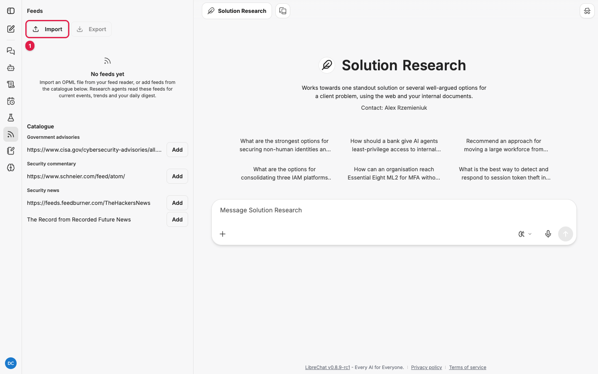

3. Choose your `.opml` or `.xml` file.
4. The panel fills in. Folders in the file become folders in the panel, and a message tells
   you what happened, for example "Added 55 feeds. 0 were already in your list."

   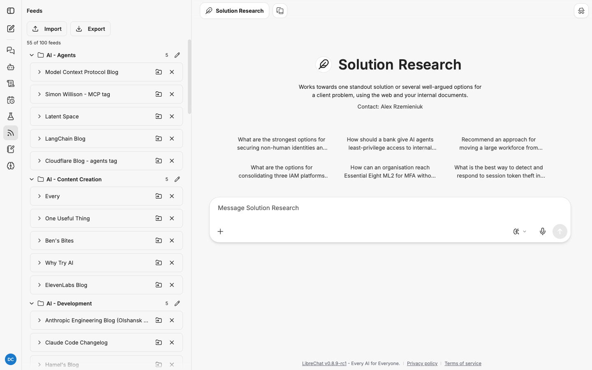

Importing the same file again adds nothing new. Feeds you already follow are filed into the
folders the file gives them, so a re-import is a safe way to restore your folder layout.

If the file would take you over your limit, the feeds that fit are added and the message says
how many were left out, for example "Added 40 feeds. 15 were left out because the limit is
100 feeds."

A starter file of AI, cyber security and identity feeds is in the repository at
[docs/ai-cyber-iam-feeds.opml](../ai-cyber-iam-feeds.opml). It is the file used for the
screenshots in this guide.

## Add feeds from the catalogue

The catalogue is a list of feeds your administrator has picked for everyone, grouped by
category. It appears at the bottom of the Feeds panel only when it has at least one feed.

1. Scroll to **Catalogue** at the bottom of the panel (callout 1).
2. Find a feed under its category and click **Add** (callout 2).

   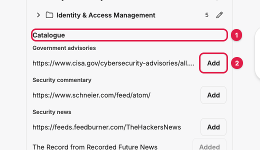

3. The button changes to **Added** and the feed joins your list, in a folder named after its
   catalogue category.

   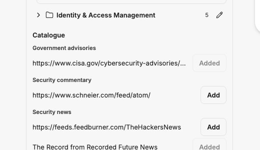

A newly curated feed shows its web address instead of a title until the poller has checked it
once, which happens within half an hour by default.

## Check that a feed is working

1. Click the chevron to the left of a feed's name (callout C above).
2. The row expands to list the feed's items from the last 45 days, newest first, each with
   its published date. Click an item to open it in a new tab.

   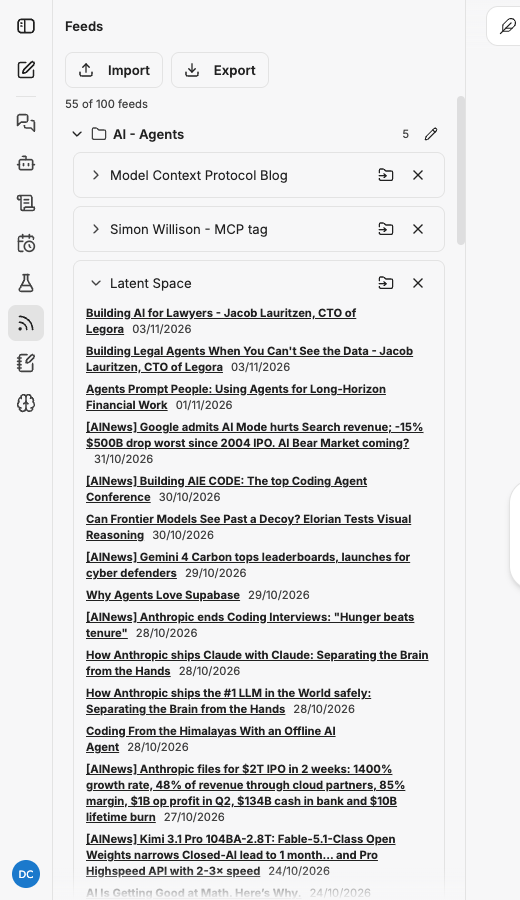

3. Click the chevron again to collapse it.

What the row can tell you:

| You see | It means |
|---|---|
| A list of recent items | The feed is being checked and has content |
| "No items in the last 45 days." | The feed is checked but quiet, or new and not checked yet |
| "The last check of this feed failed." under the name | The most recent check failed. It will be retried. One failure is common and usually clears |
| "Paused after repeated failures." under the name | Ten checks in a row failed, so polling stopped. Your subscription is kept. Ask your administrator to re-enable it once the source is fixed |
| "Cited in a report" next to an item | A delivered report cites it, so it is kept beyond 45 days |

Feeds are checked every 30 minutes by default. One check per feed serves everyone who follows
it, so a popular feed is not polled once per person.

## Organise feeds into folders

Folders do not change what the agents read; every feed you follow is read regardless of its
folder. They make it easier to see which sources feed which digest.

### Move a feed

1. Click the folder-arrow icon on the feed's row (callout D above).
2. A field opens under the feed: "Folder. Leave empty to take the feed out of folders." Type
   a folder name, or pick one of your existing folders from the suggestions (callout 1).
3. Click **Save** (callout 2). **Cancel** closes the field without changing anything.

   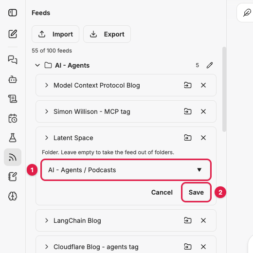

To take a feed out of all folders, clear the field and save. It moves to **Not in a folder**.

### Folders inside folders

Type the path with a space, a slash and a space between levels: `AI - Agents / Podcasts`.
The spaces matter. `AI/Agents` is a single folder whose name contains a slash.

Nested folders are listed as their full path, in alphabetical order with the other folders,
rather than drawn as an indented tree:

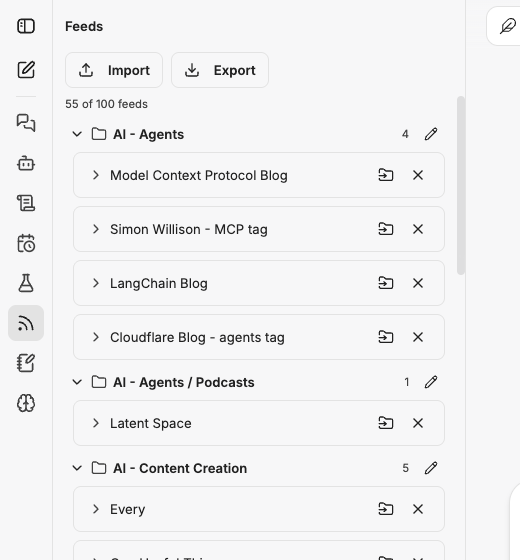

## Rename a folder

1. Click the pencil on the folder's header (callout B above).
2. A field opens: "Folder name. Use " / " for a folder inside another." Type the new name.

   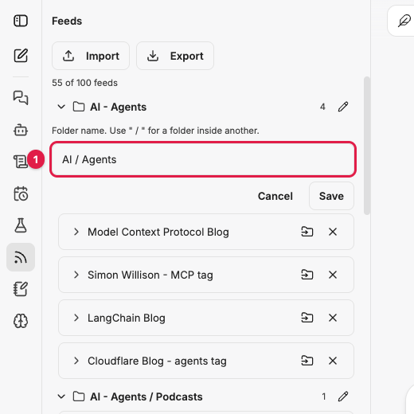

3. Click **Save**.

Subfolders move with their parent. Renaming `AI - Agents` to `AI / Agents` also renamed
`AI - Agents / Podcasts` to `AI / Agents / Podcasts`:

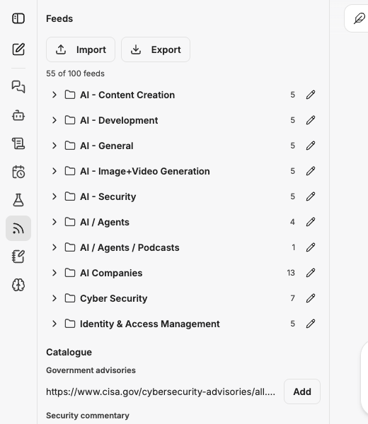

## Remove a feed

Click the cross on the feed's row (callout E above). The feed leaves your list immediately;
there is no confirmation. Reports that already cite its items keep those citations.

To get it back, add it again from the catalogue or re-import your OPML file.

## Export your feeds

Click **Export**. Your browser saves `research-feeds.opml` with every feed you follow and the
folder each one is in. Catalogue feeds you have not filed yourself are exported under their
catalogue category.

Use it as a backup before a big reorganisation, or to take your list to a feed reader.

## Limits and housekeeping

| Limit | Default | Set by |
|---|---|---|
| Feeds per person | 100 | Administrator (`research.feeds.maxPerUser`) |
| How often each feed is checked | Every 30 minutes | Administrator (`research.feeds.pollIntervalMinutes`) |
| Failed checks before a feed is paused | 10 in a row | Administrator (`research.feeds.disableAfterFailures`) |
| Item history kept | 45 days, longer for cited items | Administrator (`research.snapshots.retentionDays`) |
| Items a digest considers per run | 200, most recent first | Administrator (`research.jobs.digest.maxItems`) |

When you reach your limit, **Add** in the catalogue is refused with "You have reached your
feed limit. Remove a feed to add another."

## Troubleshooting

| Symptom | Cause | Fix |
|---|---|---|
| "That file has no feeds in it." | The file is not OPML, or holds no feed URLs | Export an OPML file from your feed reader and try again |
| "That file is too large to import." | The file is over the upload size limit | Split it, or remove feeds you do not need first |
| "The OPML file could not be imported." | The server could not read it | Try again; if it repeats, tell your administrator |
| No **Catalogue** section | Your administrator has not curated any feeds | Import an OPML file instead |
| A catalogue feed shows a web address, not a name | It has not been checked yet | Wait up to half an hour |
| A feed shows "Paused after repeated failures." | The source has been unreachable for ten checks | Check the site in your browser. If it works, ask your administrator to re-enable the feed |
| Folder layout lost after a re-import | It is not; re-import files feeds into the folders in the file | If you reorganised after exporting, export again before re-importing |
