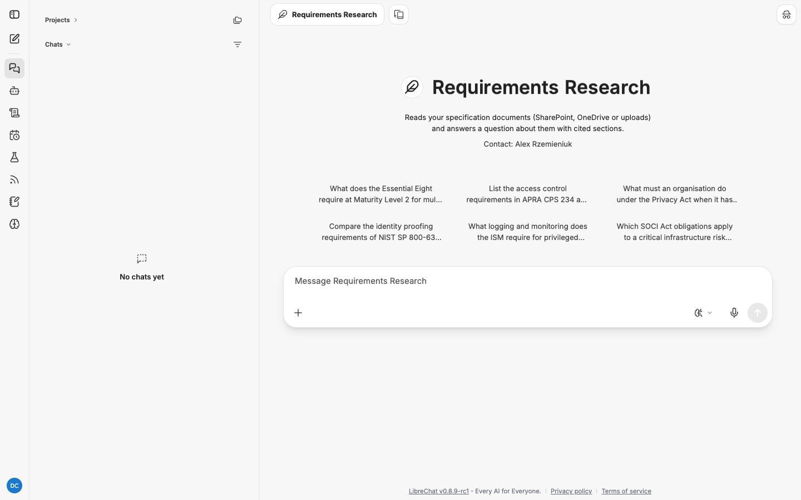

# Requirements Research: how to use it

Requirements Research reads your specification documents and answers a question about them,
citing document sections. It is the agent for "what does this standard, policy or client
specification actually require?"

| | |
|---|---|
| Reads | SharePoint and OneDrive documents you name, files you attach, and the web if the brief calls for it |
| Schedulable | No. It needs your live sign-in to read internal documents |
| Default budget | 45 minutes, 400 steps |
| Documents per job | Up to 25, read within 10 minutes of sending |
| Direct link | `/c/new?agent_id=agent_research_requirements` |

Read [research-agents.md](research-agents.md) first for how jobs run and how to read a report.

## When to use it

- Pulling the obligations out of a regulation or standard (Essential Eight, APRA CPS 234,
  ISM, SOCI, Privacy Act, NIST SP 800-63).
- Extracting requirements from a client's RFP, tender or solution specification.
- Comparing two documents and finding where they conflict.
- Checking what a document is silent on before a workshop.

Do not use it to recommend a solution. That is [Solution Research](solution-research.md).

## The one rule that matters

**The agent can only read documents you name in the message you send.** It reads them while
you are signed in, during the brief, snapshots them, and then carries on without your
sign-in. From that point it cannot discover or open anything else internal, even a document
linked from one you named. If the brief shows a document is missing, cancel and resubmit with
the link added, or submit a follow-up job naming the extra documents.

Name documents in any of these forms:

| Form | Example |
|---|---|
| A full URL | `https://contoso.sharepoint.com/sites/IAM/Shared Documents/Client-Spec.docx` |
| A SharePoint path | `sharepoint:/sites/IAM/Shared Documents/Client-Spec.docx` |
| A OneDrive path | `onedrive:/Projects/Client/Spec.docx` |
| An attached file | Use the **+** button in the message box |

Public web pages and PDFs can be named by URL too; the agent fetches them like any page.

SharePoint and OneDrive access depends on your administrator having connected the document
gateway. Without it, the agent can still read attachments and the web, and the brief tells
you it could not open internal documents.

## Run one, step by step

1. Start a new chat, click the model name, hover **My Agents** and choose
   **Requirements Research**.

   

2. To use your own documents, attach them with **+** and paste any SharePoint or OneDrive
   links into the message.
3. Write one question about them (see the examples) and send. Or click a starter, which
   uses public standards only.
4. Watch the first response. You will see one **read_document** call per named document as
   the agent reads them. This happens while you wait, before the job carries on alone.
5. Read the brief. **Sources** lists every document it read. If one is missing or marked as
   unreadable, cancel and resubmit.
6. Follow the job in the **Research** panel. When it says **Delivered**, click **Download the
   report** in the conversation.

### The six starters

| Starter |
|---|
| What does the Essential Eight require at Maturity Level 2 for multi-factor authentication? |
| List the access control requirements in APRA CPS 234 and how each is usually evidenced. |
| What must an organisation do under the Privacy Act when it has an eligible data breach? |
| Compare the identity proofing requirements of NIST SP 800-63A IAL2 and Australia's Digital ID rules. |
| What logging and monitoring does the ISM require for privileged access? |
| Which SOCI Act obligations apply to a critical infrastructure risk management program? |

## The report template

```
## Summary
## Requirements by area (one subsection per area; cite document sections)
## Conflicts, gaps and ambiguities
## Questions to resolve
```

## Worked examples

Illustrative: the shape you get back, not a recorded run. Citation numbers stand for entries
in the report's **Sources** list; for documents the entry names the document and section.

### Example 1: a public standard

**You send:**

```
What does the Essential Eight require at Maturity Level 2 for multi-factor authentication?
Use the current ACSC Essential Eight Maturity Model as the source. Australian sources only.
Group the requirements by who they apply to: users, privileged users, customers.
```

**The brief:**

```
## Question
Which controls does the ACSC Essential Eight Maturity Model require for multi-factor
authentication at Maturity Level 2, grouped by the population they apply to.

## Sources
Web: the ACSC Essential Eight Maturity Model page and its linked MFA guidance. No internal
documents were named.

## Output
Requirements report. Sections: Summary; Requirements by area, with subsections for users,
privileged users and customers; Conflicts, gaps and ambiguities; Questions to resolve.

## Exclusions
Non-Australian sources. Maturity Levels 1 and 3 except where needed to explain ML2.
```

This brief is right, so leave it running. **The report** opens:

```
> **Verification:** 31 supported, 1 unverified, 0 source unavailable (32 citations). 0 sentences carry no citation.

## Requirements by area

### Customers
- **[Unverified]** MFA used to authenticate customers to online customer services provides
  a phishing-resistant option [1].
```

The one unverified line is a signal to open the citation and read the exact wording yourself
before you quote it to a client.

### Example 2: a client specification against a standard

```
Compare the identity requirements in the client's solution specification against APRA
CPS 234 and list every place the specification is weaker than the standard.

Client specification:
sharepoint:/sites/ClientX/Shared Documents/IAM Uplift/Solution-Specification-v3.docx

Standard:
https://www.apra.gov.au/sites/default/files/cps_234_july_2019_for_public_release.pdf

Output as a table: requirement, what CPS 234 says, what the specification says, gap.
```

The first response reads both documents. The brief then lists them under **Sources** and
says no further documents can be read in this job: the submission window is closed. The
report's **Requirements by area** section is the table you asked for, each cell citing a
section of one of the two documents.

### Example 3: attached files only

Attach three RFP PDFs to the message and send:

```
List every identity, access and privileged access requirement across the attached RFP
documents. Keep the requirement numbering the client used. Flag duplicates across the
three documents.
```

The agent searches the attachments through the upload index. Citations resolve to the file
and a page or chunk.

## Tips

- **Paste the link, not the title.** "The CPS 234 standard" is a phrase. A URL is a source.
- **Say which version** when a document has several. The agent snapshots what the link
  points at.
- **Ask for numbering to be preserved** when the client's own numbering matters.
- **Narrow the question** if you get a partial report. "All requirements" across a 200-page
  specification is a lot for 400 steps. "Access control requirements in sections 4 to 6" is
  not.
- **Web is a fallback here, not the point.** If you do not want the web used, say "internal
  documents only".

## Troubleshooting

The agent's tool calls in the first response show why a document could not be read:

| Message in the tool result | Cause | Fix |
|---|---|---|
| "Document access is not configured." | The document gateway is not connected | Attach the files instead, or ask your administrator (see [administration.md](administration.md#connect-sharepoint-and-onedrive)) |
| "The document could not be fetched." | Wrong link, or you do not have access | Check the link opens for you in a browser |
| "Only documents the user named when submitting the job can be read." | The agent tried a document you did not name | Resubmit naming it |
| "The time allowed for reading documents at submission has passed." | Reading took more than 10 minutes | Split the documents across two jobs |
| "This job has already read the maximum of 25 documents." | More than 25 named | Split into two jobs |

| Other symptom | Cause | Fix |
|---|---|---|
| Report cites the web when you wanted documents | The brief allowed web | Resubmit with "internal documents only" |
| A schedule using this agent fails every run with "This research job cannot run on a schedule." | By design: the schedule dialog lists every agent, but Requirements jobs need your live sign-in | Delete the schedule and run the job from a chat |
