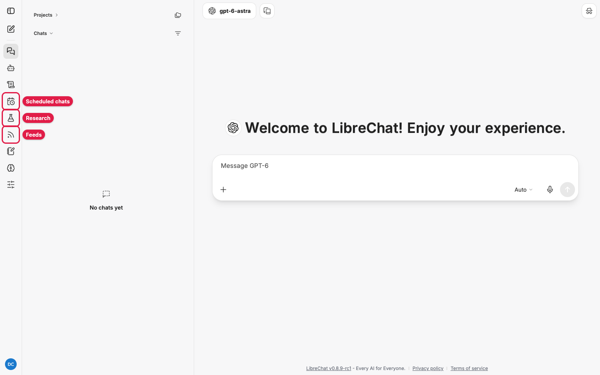
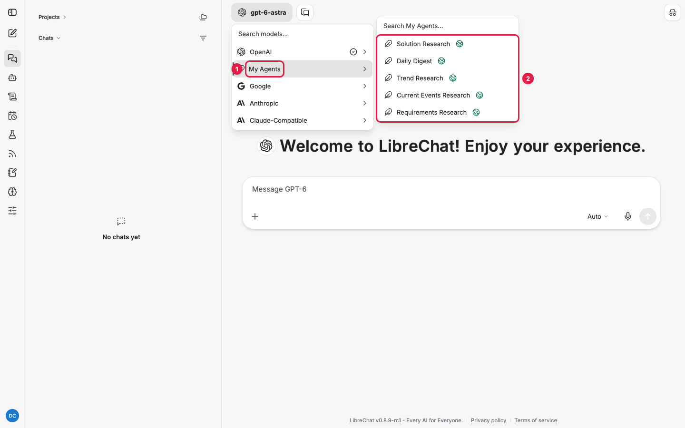
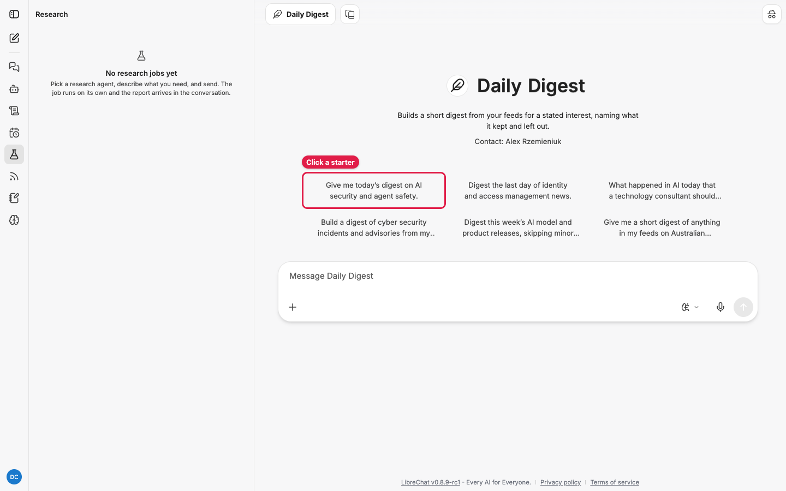
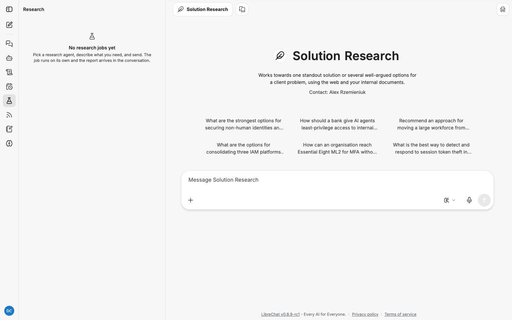
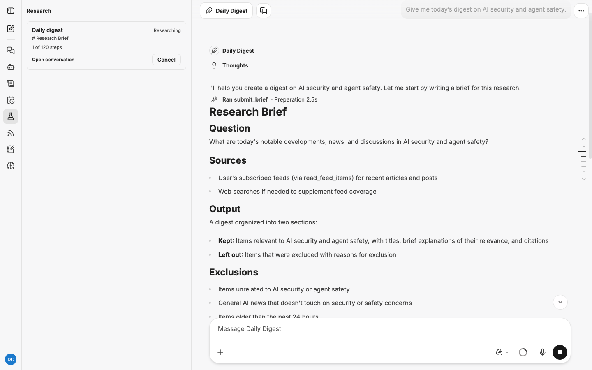
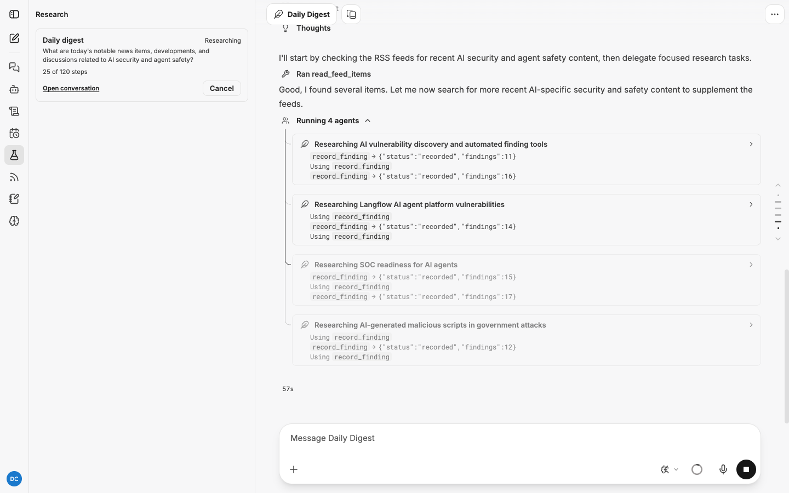
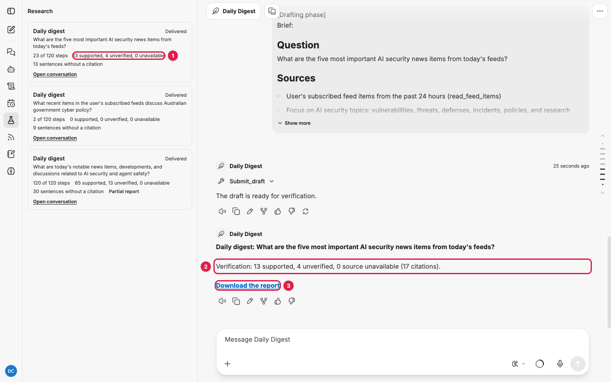
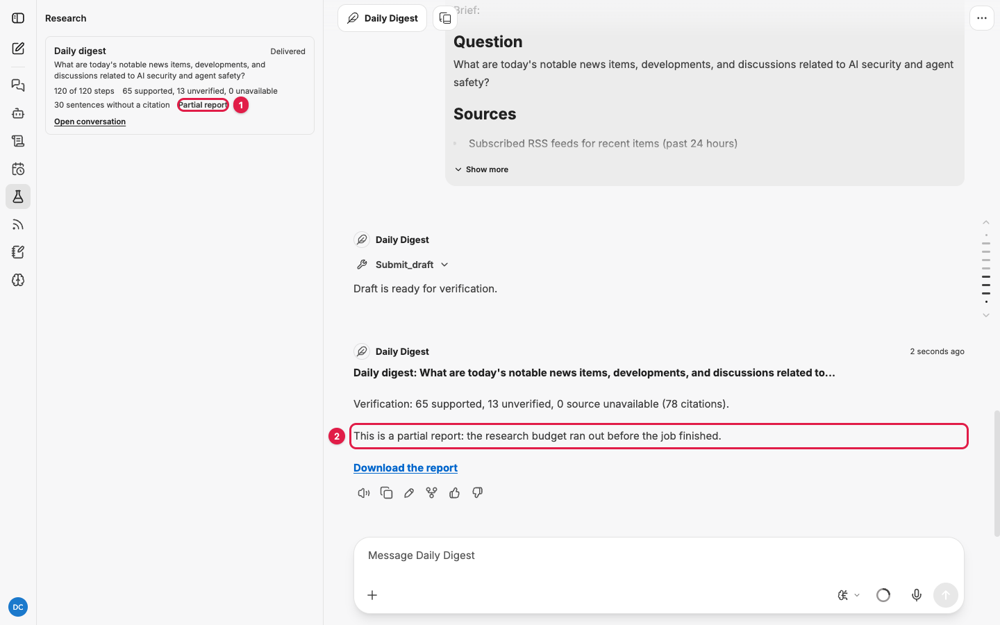
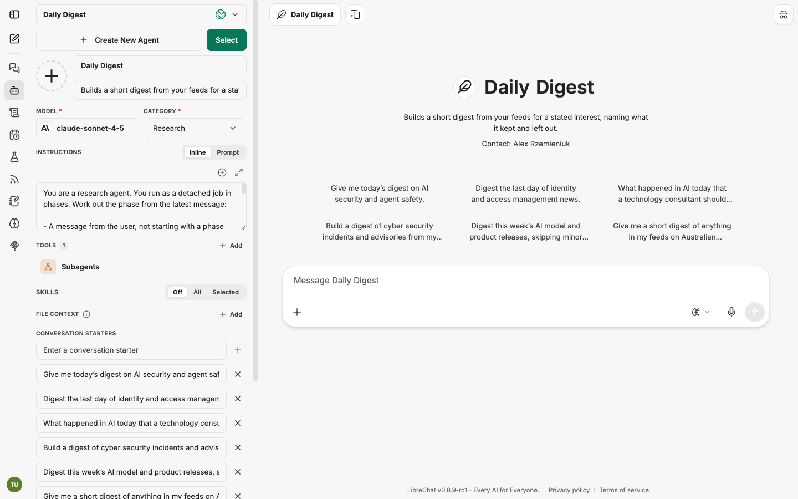
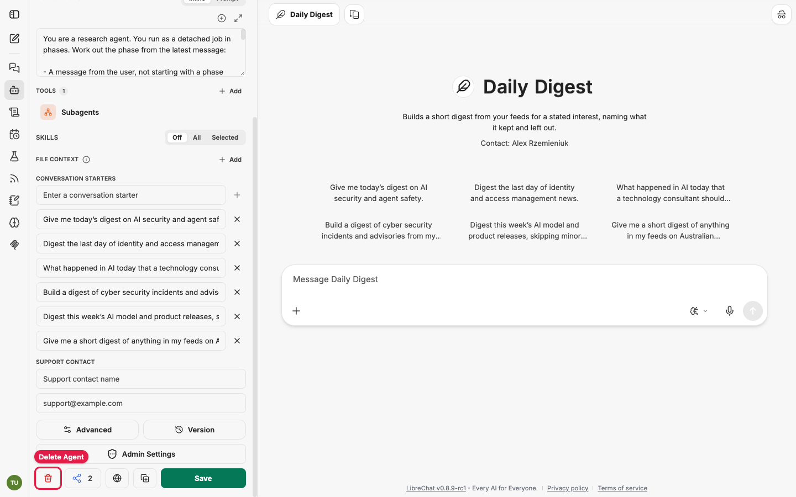

# Research agents: the general guide

You pick a research agent, describe what you need, and send. The job runs on its own, in
phases, and the finished report lands in the conversation as a markdown file. Every factual
sentence in that report cites a source the agent read during the run. Nothing comes from the
model's memory, and a separate checking pass tells you which citations hold up.

This guide covers what all five agents share. Each agent has its own guide with the six
conversation starters and worked examples:
[Requirements](requirements-research.md), [Current Events](current-events-research.md),
[Trends](trend-research.md), [Daily Digest](daily-digest.md) and
[Solution](solution-research.md). Feeds and scheduling have guides of their own:
[feeds.md](feeds.md) and [scheduling.md](scheduling.md).

## Contents

- [Before you start](#before-you-start)
- [Run a research job, step by step](#run-a-research-job-step-by-step)
- [What happens while it runs](#what-happens-while-it-runs)
- [Read the report](#read-the-report)
- [The Research panel](#the-research-panel)
- [Cancel a job](#cancel-a-job)
- [Write a good request](#write-a-good-request)
- [Budgets and limits](#budgets-and-limits)
- [When something goes wrong](#when-something-goes-wrong)
- [The agents themselves](#the-agents-themselves)
- [Privacy and ownership](#privacy-and-ownership)

## Before you start

- **Research must be switched on.** Look at the rail on the far left. A flask icon is the
  **Research** panel and an RSS icon is the **Feeds** panel; the calendar-with-clock icon
  above them is **Scheduled chats**. Hover any icon to see its name. If Research and Feeds
  are missing, research is off for your account; your administrator turns it on (see
  [administration.md](administration.md)).

  

- **Feeds are optional** for Current Events and Trends, and essential for the Daily Digest.
  See [feeds.md](feeds.md).
- **Scheduling is a separate switch.** If your rail has no calendar icon (**Schedules**),
  scheduled research is not available to you yet. See [scheduling.md](scheduling.md).
- **Email delivery** needs an email service configured by your administrator and a
  verified email address on your account.

## Run a research job, step by step

### 1. Start a new chat with a research agent

Click the pencil icon at the top of the rail for a new chat. Then click the model name at
the top of the chat (it shows whichever model or agent you last used).

1. Hover **My Agents** (callout 1).
2. Click the research agent you want (callout 2): **Requirements Research**,
   **Current Events Research**, **Trend Research**, **Daily Digest** or
   **Solution Research**.



You can also type part of the name into **Search My Agents...**, or use a
[direct link](README.md#direct-links-to-each-agent).

There is no front door that guesses which agent you want. You choose.

### 2. Pick a starter or write your own request

The chat now shows the agent's name, a one-line description and six conversation starters.
Each starter is a complete request, so clicking one sends it straight away.



To write your own, type into the message box and press Enter. See
[Write a good request](#write-a-good-request) for what makes the brief land.

For Requirements and Solution jobs, attach files with the **+** button or paste SharePoint
and OneDrive links into the message before you send. The agent can only read documents you
name in this first message.

### 3. Open the Research panel

Click the flask icon on the rail. The panel lists your jobs, newest first.



Your job appears here as soon as the conversation is saved, and its card updates on its own
while the job runs.

### 4. Read the brief

Within a few seconds the agent writes a brief and posts it into the conversation, under
**Ran submit_brief**. It restates your request under four headings:

- **Question**: what the agent thinks you asked.
- **Sources**: what it intends to read.
- **Output**: the shape of the report.
- **Exclusions**: what it will leave out.



Read it now. The brief governs everything that follows. If it misunderstands you, cancel the
job (see [Cancel a job](#cancel-a-job)) and resubmit with a tighter request. Waiting for the
report will not fix a wrong brief.

### 5. Let it research

The conversation then shows **Running N agents**: the agent has split your question into
narrow sub-questions and handed each to a subagent. Each card shows that subagent's latest
tool calls, for example `search_web`, `fetch_page` and `record_finding`. The Research panel
shows **Researching** and the steps used so far.



You do not need to watch. Close the tab if you like; the job keeps running on the server.

### 6. Collect the report

When the panel shows **Delivered**, the job's conversation has a final message from the
agent:

1. The Research panel's job card shows the verification counts.
2. The conversation message shows the same counts as a line beginning **Verification:**.
3. **Download the report** saves the full report as a markdown file, named after the job
   type and date (for example `digest-report-2026-11-03.md`).



Open the file in any markdown viewer or editor (VS Code, Obsidian, Typora) or paste it into
a document.

## What happens while it runs

Every job moves through the same phases. The Research panel shows which one it is in.

| Panel shows | What is happening |
|---|---|
| **Queued** | You sent the message. The job is waiting for a worker to pick it up |
| **Writing the brief** | The agent restates your request as Question, Sources, Output, Exclusions |
| **Researching** | Subagents search, fetch and record findings. Every finding is a claim plus the snapshot it came from plus a locator (a heading, section or short quote) |
| **Drafting** | The report is written from the recorded findings using the agent's template. Every factual sentence must end with a citation |
| **Checking citations** | A separate pass re-opens each cited snapshot and asks a verification model whether that passage alone supports the claim |
| **Delivered** | The report is attached to the conversation |
| **Failed** | The job stopped with a reason; see [When something goes wrong](#when-something-goes-wrong) |
| **Cancelled** | You cancelled it |

Each phase is run as a separate turn, so you will see messages starting "[Research phase]",
"[Drafting phase]" and so on in the conversation, shown under your name. They are the job's
own instructions to each phase, not something you sent.

If the job runs out of time or steps it stops researching and drafts with what it has. The
report is then marked **Partial report** in the panel (callout 1), in the conversation
message (callout 2) and at the top of the file. The broad digest in this screenshot ran under
the earlier 120-step default and used all of it; asking for fewer items keeps a digest inside
its budget.



If even drafting cannot run, for example because the server restarted mid-job, the job waits
until its wall-clock deadline and delivers a fallback: a plain **Findings** list of every
recorded claim with its citation, still checked. See the real example in
[current-events-research.md](current-events-research.md#a-real-run-what-an-interrupted-job-delivers).
A job that produces nothing at all is a bug, not an expected outcome.

The delivered digest above asked for "the five most important items only" and took two
minutes from send to delivery: about ten seconds for the brief, a minute researching (it read
the feeds and fetched the pages itself, without subagents), half a minute drafting, and about
ten seconds checking 17 citations. The broad digest in the research-phase screenshot split
the work across four subagents, ran for about seven minutes and used its whole step budget.

## Read the report

### The verification line

Every report opens, under its title, with a summary of the checking pass. This is the real
line from one of the Daily Digest runs captured for these guides:

```markdown
> **Verification:** 63 supported, 4 unverified, 0 source unavailable (67 citations). 54 sentences carry no citation.
```

- **Supported**: the verifier found the claim in the cited passage.
- **Unverified**: the verifier could not confirm the claim from the passage alone. The
  sentence starts with **[Unverified]** and keeps its citation so you can check it yourself.
  Treat it as a lead, not a fact.
- **Source unavailable**: the snapshot could not be re-opened. The sentence starts with
  **[Source unavailable]**. Same advice.
- **Sentences without a citation**: sentences with no citation marker at all. For most
  agents this should be near zero, and a high number means the agent asserted things it
  could not trace. For the Daily Digest it is naturally higher, because each kept item ends
  with a line on why it matters to your interest, and that line is the agent's judgement,
  not a sourced fact.

### Citations and sources

In the file, citations are numbered markers like `[1]` that point at a **Sources** list at
the end. Each source gives the page title and link, the date it was fetched and the snapshot
id the verifier checked:

```markdown
## Sources

1. [Chinese hackers use ARTEX AI in automated attacks against 200 orgs](https://www.bleepingcomputer.com/...),
   fetched 2026-11-03 (snapshot snap_aiHcnx3jLHEy)
```

For feed items the link is the item's own link. For documents it is the document reference
you named. For an attached file it is the file and a page or chunk locator.

### Other sections you may see

- **Scope notes**: added by the checking pass when the report wandered from the brief.
- **Partial report**: a callout under the verification line when the budget ran out.
- Required sections: Trend reports always have **What changed since the last report** and
  digests always have **Left out**. If the draft forgot one, the heading is added with a
  note saying it was missing, so the gap is visible.

### How much to trust a report

Read the verification line first. Then read every **[Unverified]** sentence and open its
source before you repeat it to anyone. Supported means "the cited page says this", not "this
is true": the agent can still cite a weak source accurately. The Sources list tells you how
good the sources were.

## The Research panel

Open it from the flask icon. Each job is a card showing:

- the job type (top left) and its status (top right);
- steps used against the budget, for example "118 of 300 steps";
- once delivered, the verification counts and the number of sentences without a citation;
- **Open conversation** to jump to the job's conversation;
- **Cancel** while the job is still running.

Below the job list, **Scheduled research** lists your schedules that run a research agent.
See [scheduling.md](scheduling.md).

## Cancel a job

1. Open the **Research** panel.
2. Find the running job and click **Cancel**.

Cancelling takes effect between phases, so a job in the middle of drafting finishes that
phase before it stops. A cancelled job delivers nothing. Resubmit with a better request if
the brief was wrong.

## Write a good request

The brief phase is the agent reading your mind. Make that easy.

- **One question per job.** "What does the Essential Eight require for MFA at ML2?" works.
  "Tell me about the Essential Eight" does not. If you have three questions, submit three
  jobs.
- **Name the sources you care about.** For Requirements and Solution jobs, paste the links
  or attach the files. The agent can only read documents named at submission. It cannot go
  looking for more mid-run.
- **State the output you want** if the default template is not right. "Keep it to one page"
  or "a table of options" is honoured where the template allows.
- **Say what to exclude.** "Ignore vendor marketing" or "Australian sources only" lands in
  the Exclusions heading of the brief and shapes the search.
- **Give a time window** for anything current: "this fortnight", "since 1 October", "the
  past two weeks".

The starters are deliberately short. They work, but the brief fills the gaps with guesses.
Compare the starter "Give me today's digest on AI security and agent safety." with:

```
Give me today's digest on AI security and agent safety. Keep anything about attacks on or
through AI agents, model safety research with a security angle, and vendor security
features. Leave out general AI product news and funding announcements.
```

The second gives the brief its Exclusions instead of making it invent them.

## Budgets and limits

Defaults, each adjustable by your administrator in `librechat.yaml`:

| Job | Wall clock | Steps |
|---|---|---|
| Requirements | 45 minutes | 400 |
| Current Events | 30 minutes | 300 |
| Trends | 30 minutes | 300 |
| Daily Digest | 15 minutes | 200 |
| Solution | 60 minutes | 500 |

- At 85 percent of the wall clock the agent stops researching and drafts.
- Two jobs per user may run at once. Sending a third while two are running is refused with
  "You have reached the limit of research jobs running at once." Send it again when one
  finishes.
- One job per conversation at a time. A message sent into a conversation whose job is still
  running is refused with "A research job is already running in this conversation." Start a
  new chat for a second job.
- Snapshots of what the agent read are kept for 45 days, or for good once cited in a
  delivered report.
- Documents fetched at submission for Requirements and Solution jobs: up to 25, within 10
  minutes.
- The checking pass verifies up to 400 citations per report.

## When something goes wrong

| What you see | What it means | What to do |
|---|---|---|
| "You have reached the limit of research jobs running at once." | Two of your jobs are already running | Wait for one to finish, or cancel one, then send again |
| "A research job is already running in this conversation." | You sent a follow-up into a running job's conversation | Start a new chat for the new request |
| "Research agents are not enabled." | Research is switched off | Ask your administrator |
| "The job could not write its brief. Try submitting it again." | The first model call failed before anything was recorded | Submit again. If it repeats, tell your administrator |
| "The report could not be checked and delivered after several attempts." | Checking or delivery failed five times | Submit again |
| "The job stopped before it could produce a report." | Another fatal error | Submit again; if it repeats, tell your administrator with the time of the job |
| **Partial report** | The budget ran out before research finished | Narrow the question, or ask your administrator to raise the budget |
| "Delivered with warnings: the email copy could not be sent." | The report is in the conversation; email failed after retries | The conversation copy is complete. Check with your administrator |
| "Delivered with warnings: the email copy was not sent because your email address is not verified." | Your address is unverified | Verify your email address in your account |
| Many **[Unverified]** sentences | Sources were thin, hedged, or the agent over-reached | Read the citations; consider a narrower question or better sources |
| The brief misses the point | Your request was ambiguous | Cancel, rewrite with a single clear question and named sources |
| A job sits in one phase for a long time with no new activity in the conversation | The server restarted while that phase was running | Wait. When the job's wall-clock budget runs out, it delivers whatever it gathered as a **Partial report**. Resubmit if you need the full run |

## The agents themselves

The five agents are created with fixed ids every time the backend starts, if they are
missing. They live in the **Research** category and are visible to every user.



- **They cannot be deleted while research is enabled.** **Delete Agent** in the Agent Builder
  is refused with "This research agent is managed by the system and cannot be deleted while
  research is enabled." Schedules and jobs refer to the agents by id, so deleting one would
  only break things until the next restart recreated it.

  

- **Administrators can edit them.** Instructions and conversation starters can be changed in
  the Agent Builder and are kept across restarts. The model and provider come from
  `librechat.yaml`.
- **If one is ever missing**, restarting the backend recreates it with the shipped defaults.
  Edits made to the deleted copy are not recovered.

## Privacy and ownership

Reports, jobs, snapshots, feed subscriptions and schedules belong to you alone. Nobody else
can see them. The only shared data is the raw feed poll cache, which is public RSS.
Scheduled runs never carry your SharePoint or OneDrive credentials, which is why
Requirements and Solution jobs cannot be scheduled.
