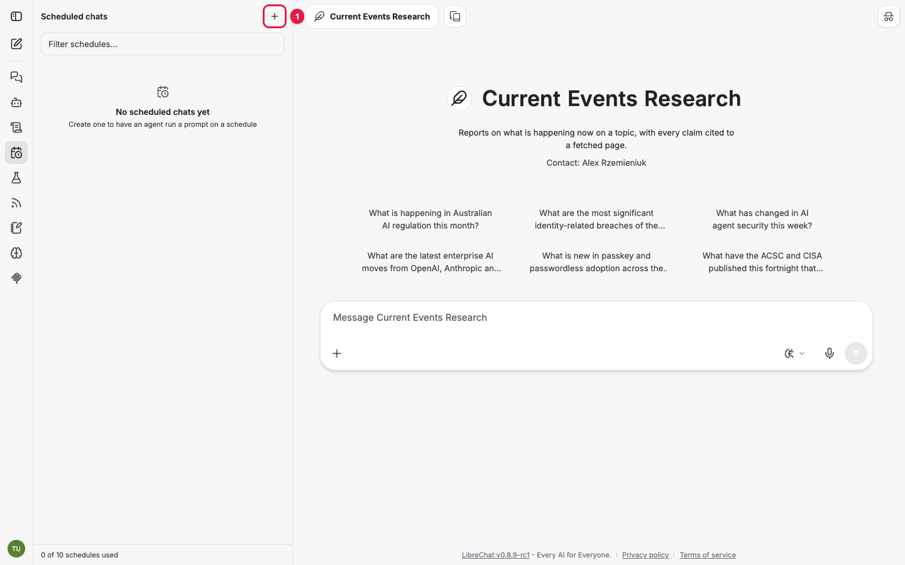
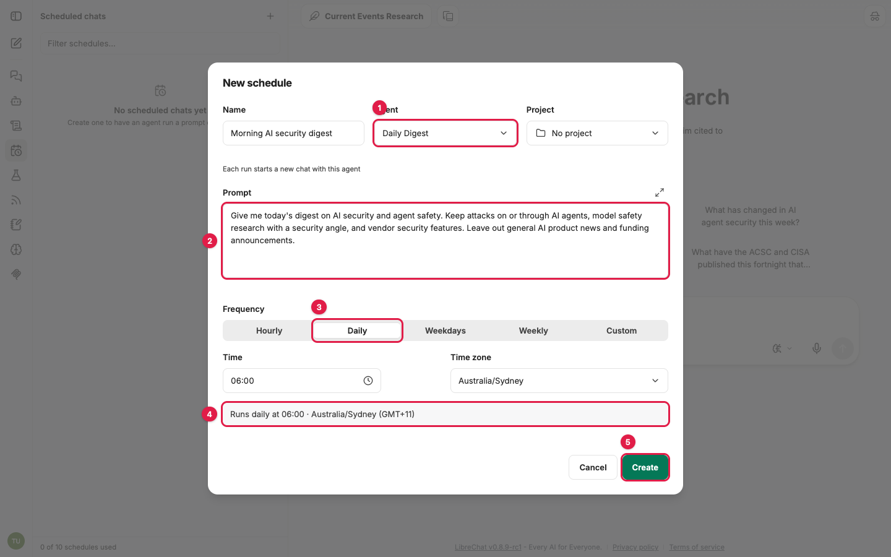
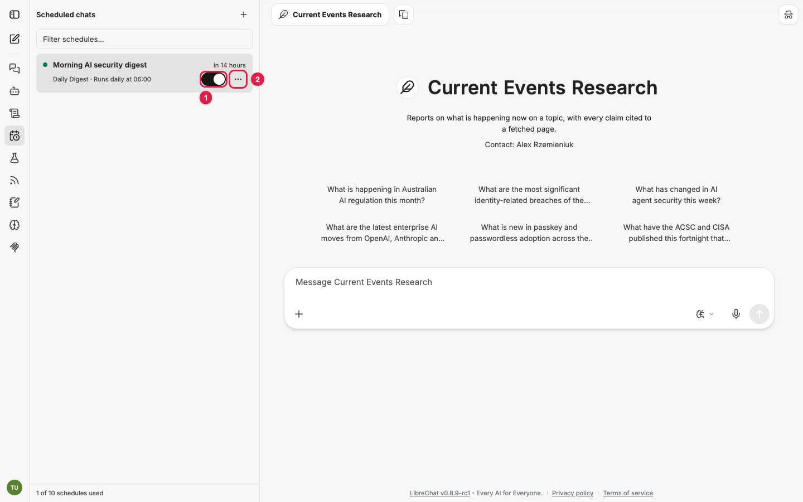
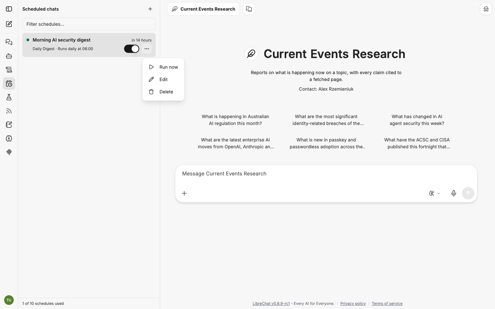
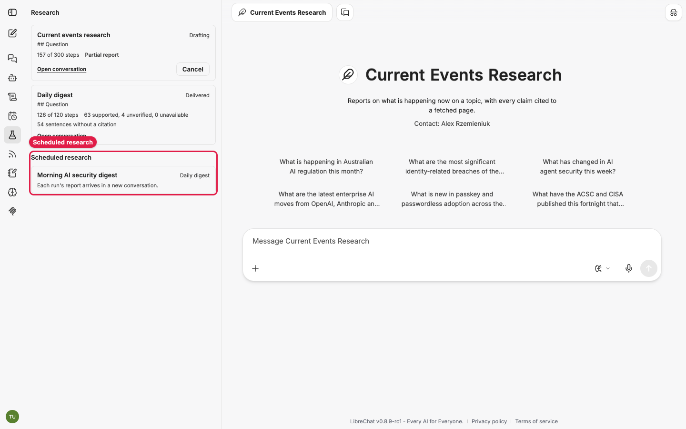

# Scheduling research: get reports without asking

Three of the five agents can run on a schedule: **Current Events Research**,
**Trend Research** and **Daily Digest**. Each run is a full research job, and each one
delivers its report into a new conversation, and by email if you switch that on.

Requirements and Solution Research cannot be scheduled, because they read internal documents
with your live sign-in, and a scheduled run has no sign-in to borrow.

## Contents

- [Before you start](#before-you-start)
- [Create a research schedule, step by step](#create-a-research-schedule-step-by-step)
- [Choose a frequency](#choose-a-frequency)
- [Get each report by email](#get-each-report-by-email)
- [What happens on each run](#what-happens-on-each-run)
- [Edit, pause or delete a schedule](#edit-pause-or-delete-a-schedule)
- [Limits](#limits)
- [Troubleshooting](#troubleshooting)

## Before you start

- **Look for Scheduled chats on the rail**: a calendar-with-clock icon. If it is not there,
  your administrator has not switched scheduling on. See
  [administration.md](administration.md#switch-on-scheduling).
- **Run the request by hand first.** Send the same prompt to the agent in a normal chat, read
  the brief and the report, and adjust the wording until you like the result. A schedule
  repeats whatever you give it.
- **For a Daily Digest, set up your feeds first.** See [feeds.md](feeds.md).

## Create a research schedule, step by step

1. Click **Scheduled chats** on the rail, then **New schedule** (callout 1). The panel also
   shows how many of your schedules are used, for example "0 of 10 schedules used".

   

2. Fill in the **New schedule** dialog:

   

   | Field | What to enter |
   |---|---|
   | **Name** | Something you will recognise in your chat list, for example "Morning AI security digest" |
   | **Agent** (callout 1) | Current Events Research, Trend Research or Daily Digest. The list also shows Requirements and Solution Research; do not pick those, their runs are refused |
   | **Project** | Optional. Runs are filed into this chat project |
   | **Prompt** (callout 2) | The request, exactly as you would type it in a chat. For a digest, your interest statement. For trends, the topic as a standing question |
   | **Frequency** (callout 3) | See [Choose a frequency](#choose-a-frequency) |
   | **Time** and **Time zone** | When it runs. The time zone defaults to your browser's |

3. Check the summary line (callout 4), for example "Runs daily at 06:00 · Australia/Sydney
   (GMT+11)".
4. Click **Create** (callout 5). A "Schedule created" message appears and the schedule joins
   the list with its next run, for example "in 14 hours", and a summary such as
   "Daily Digest · Runs daily at 06:00".

   

5. **Test it straight away.** Click the **...** options button (callout 2) and choose
   **Run now**. The run starts at once in a new conversation, without waiting for the
   schedule time, and its job appears in the Research panel.

   

## Choose a frequency

| Frequency | Good for | Example |
|---|---|---|
| **Daily** | Daily Digest | Every day at 06:00 |
| **Weekdays** | A working-day digest | Monday to Friday at 07:30 |
| **Weekly** | Current Events briefings, fast-moving trends | Mondays at 07:00 |
| **Custom** | Fortnightly or monthly trends | A cron expression, see below |
| **Hourly** | Rarely useful for research | Research runs take minutes and reports pile up |

**Custom** takes a cron expression with five fields: minute, hour, day of month, month, day
of week. For example:

| Cron | Runs |
|---|---|
| `0 7 1 * *` | 7:00am on the 1st of every month |
| `0 7 1,15 * *` | 7:00am on the 1st and 15th, roughly fortnightly |
| `30 6 * * 1-5` | 6:30am Monday to Friday |

If the expression can never run, the dialog says "This expression never runs. Check the
field order and values." Runs must be at least the administrator's minimum interval apart (60
minutes by default).

## Get each report by email

Every run delivers to a new conversation. Email is an extra copy, set per schedule in the
**Research** panel rather than in the schedule dialog.

1. Open the **Research** panel (the flask icon).
2. Scroll to **Scheduled research**, below your jobs. It lists each of your schedules that
   runs a research agent, with its name and job type.

   

3. Switch on **Also send each report by email** for the schedule you want.

If the row says "Each run's report arrives in a new conversation." instead of showing the
switch, email is not available on your LibreChat; your administrator has not set up an email
service or has turned research email off.

The email carries the report and a link to the conversation. It is only sent to a verified
email address; an unverified address gives "Delivered with warnings: the email copy was not
sent because your email address is not verified." A failed email is retried on its own
without re-running the research, and never turns a delivered report into a failure.

## What happens on each run

- **A new conversation per run.** It appears in your chat list with the run's report.
- **Web and feeds only.** Scheduled runs never touch SharePoint or OneDrive, whatever the
  prompt says.
- **Trend Research remembers.** Each run loads that schedule's most recent delivered reports
  (three by default) and must say what changed since them. Delete the schedule and the
  memory goes with it. See [trend-research.md](trend-research.md#how-what-changed-works).
- **Daily Digest picks up where it left off.** Each run reads feed items published since the
  schedule's last delivered run, so a failed run is covered by the next one.
- **The same budgets apply** as a chat run. The job appears in the Research panel like any
  other.

## Edit, pause or delete a schedule

Open **Scheduled chats** and use the schedule's entry in the list:

- The switch on the entry (callout 1 in the screenshot above) pauses and resumes it. A paused
  schedule shows **Paused** in the list and under **Scheduled research** in the Research
  panel.
- **...** then **Run now** runs it immediately, whether or not it is paused.
- **...** then **Edit** reopens the dialog with its current settings. Avoid changing a trend
  schedule's prompt often; each change shifts what the next run compares against.
- **...** then **Delete** removes it. Conversations from earlier runs stay in your chat list.

A schedule can also be disabled for you, with the reason shown on it, for example
"Disabled: too many failures" after five failed runs in a row, or "Disabled: agent deleted".

## Limits

Defaults, set by your administrator:

| Limit | Default |
|---|---|
| Schedules per person (all agents, not just research) | 10 |
| Minimum time between runs | 60 minutes |
| Failed runs in a row before a schedule is disabled | 5 |

## Troubleshooting

| Symptom | Cause | Fix |
|---|---|---|
| No **Scheduled chats** on the rail | Scheduling is off for your account | Ask your administrator |
| **Create** shows a red "Error" message and nothing is saved | The scheduler is not running on the server | Tell your administrator: the server log says why. See [administration.md](administration.md#switch-on-scheduling) |
| Every run fails with "This research job cannot run on a schedule." | The schedule uses Requirements or Solution Research | Delete it; run those agents from a chat |
| No email arrives | Email not offered, switched off, or your address is unverified | Check **Scheduled research** in the Research panel and verify your address |
| Trend reports always say "This is the first report" | Earlier runs failed, or the schedule was recreated | Check the Research panel for failed runs; keep one schedule per topic |
| A digest covers two days | The previous run failed | Nothing to do; the window resets on the next delivered run |
