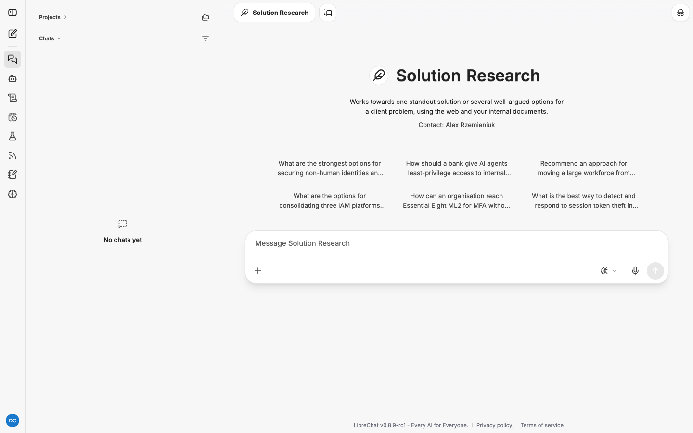

# Solution Research: how to use it

Solution Research works towards an answer. Given a client problem, it produces one standout
option or several well-argued options, each resting on cited evidence, and a recommendation.
It is the strictest of the five agents: every option and the recommendation must trace to
findings.

| | |
|---|---|
| Reads | Web search, vendor documentation, SharePoint and OneDrive documents you name, files you attach |
| Schedulable | No. It needs your live sign-in to read internal documents |
| Default budget | 60 minutes, 500 steps |
| Documents per job | Up to 25, read within 10 minutes of sending |
| Direct link | `/c/new?agent_id=agent_research_solution` |

Read [research-agents.md](research-agents.md) first for how jobs run and how to read a report.

## When to use it

- A client has a problem and you need options with trade-offs before a design decision.
- Comparing approaches or products against a stated set of constraints.
- Turning prior work plus public evidence into a recommendation.
- Pressure-testing an approach you are leaning towards.

For "what does the standard require", use [Requirements Research](requirements-research.md).
Solution Research assumes the requirement is understood and asks how to meet it.

## The one rule that matters

As with Requirements Research, **the agent can only read internal documents you name in the
message you send.** It reads them while you are signed in, during the brief, then carries on
alone. Name prior work, client specifications and architecture documents up front, as URLs,
as `sharepoint:/...` or `onedrive:/...` paths, or by attaching files. The full list of forms
and the error messages are in [requirements-research.md](requirements-research.md#the-one-rule-that-matters).

## Run one, step by step

1. Start a new chat, click the model name, hover **My Agents** and choose
   **Solution Research**.

   

2. Attach documents with **+** and paste any SharePoint or OneDrive links.
3. Write the problem with its context and constraints (see "Write the problem") and send.
4. Watch the first response read your documents, then read the brief. Check the constraints
   in **Question** and the **Exclusions**; the options will only be as good as those.
5. Follow the job in the **Research** panel. Solution jobs regularly use half their hour.
6. When the panel says **Delivered**, click **Download the report** in the conversation.

### The six starters

| Starter |
|---|
| What are the strongest options for securing non-human identities and service accounts at scale? |
| How should a bank give AI agents least-privilege access to internal APIs? |
| Recommend an approach for moving a large workforce from passwords to passkeys. |
| What are the options for consolidating three IAM platforms after a merger? |
| How can an organisation reach Essential Eight ML2 for MFA without breaking legacy systems? |
| What is the best way to detect and respond to session token theft in Microsoft Entra ID? |

The starters have no client context, so they produce generic options. Use them to see the
shape of the report, then write your own with constraints.

## The report template

```
## The problem as understood
## Options (one subsection per option: what it is, how it fits, trade-offs, risks, cost signals)
## Recommendation (one standout option, or why the choice depends on named factors)
## Open questions
```

## Write the problem

The quality of the recommendation tracks the quality of the problem statement. Give the
agent:

- **The client and context.** Sector, scale, regulatory environment.
- **The constraint set.** Must-haves, must-nots, timelines, existing platforms.
- **What "good" looks like.** The outcome, not the product.
- **The documents.** Prior work, the client's architecture, the specification.

## Worked examples

Illustrative: the shape you get back, not a recorded run. Citation numbers stand for entries
in the report's **Sources** list.

### Example 1: web only

**You send:**

```
How should a bank give AI agents least-privilege access to internal APIs?

Context: an Australian retail bank, APRA regulated, Microsoft Entra ID for workforce
identity, APIs fronted by an API gateway, and a pilot of coding and operations agents that
need to call those APIs. The security team will not accept shared service accounts or
long-lived API keys for agents.

Give me three or four options with trade-offs and recommend one. Cost signals where you can
find them. Vendor documentation is fine as a source; vendor marketing is not.
```

**The brief:**

```
## Question
How an APRA-regulated Australian bank on Microsoft Entra ID can grant AI agents least-
privilege access to internal APIs behind a gateway, without shared service accounts or
long-lived keys.

## Sources
Web: Microsoft Entra documentation on workload identities, API gateway vendor
documentation, APRA CPS 234 and CPG 234 where they bear on access, and published reference
architectures. No internal documents were named.

## Output
Solution report: The problem as understood; three to four Options, each with what it is,
how it fits, trade-offs, risks and cost signals; Recommendation; Open questions.

## Exclusions
Vendor marketing material without technical documentation behind it. Solutions that rely on
shared service accounts or static API keys.
```

**The report** extract:

```
## Options

### Option 1: Entra workload identities with federated credentials per agent
**What it is.** Each agent runs as a workload identity and exchanges a platform-issued token
for a short-lived Entra token via workload identity federation [2].
**How it fits.** Stays inside Entra; the gateway validates Entra tokens it already trusts [3].
**Trade-offs.** One identity per agent, which is manageable at pilot scale and heavy at
hundreds of agents [2].
**Cost signals.** **[Unverified]** Workload identities are licensed per identity above the
free tier [4].

## Recommendation
Option 1 for the pilot, with Option 2's broker pattern designed in from the start so that
per-task scoping can be added without re-platforming [2] [5].
```

The unverified pricing claim is exactly the kind of thing you check before it reaches a
client deck.

### Example 2: with internal documents

```
What are the options for consolidating three IAM platforms after a merger?

The merged entity runs Okta (acquirer), Microsoft Entra ID (target A) and Ping (target B).
Constraints and current state are in:
sharepoint:/sites/ClientY/Shared Documents/Integration/Current-State-IAM.docx
sharepoint:/sites/ClientY/Shared Documents/Integration/Integration-Principles.pdf

Our prior work on a similar consolidation:
sharepoint:/sites/IAM-Practice/Shared Documents/Case Studies/Bank-Merger-IAM-2025.pptx

Options should cover target platform, migration sequencing and coexistence period.
Recommend one and say what would change the recommendation.
```

The first response reads the three documents. The brief lists them under **Sources** and
says no further documents can be read. The report cites the client's current state for
constraints, the prior case study for lessons, and vendor documentation for migration
tooling, side by side.

### Example 3: pressure-testing a leaning

```
We are leaning towards a passkey-first rollout for a 20,000-person workforce. Attached is
our draft approach. Find the strongest arguments against it and the alternatives we should
have considered, then tell us whether to proceed.
```

Attach the draft. The agent treats your draft as the problem statement and researches
against it. **Options** includes your approach alongside the alternatives, and
**Recommendation** says whether to proceed and under what conditions.

## Tips

- **Constraints are the brief.** The more must-haves and must-nots you give, the sharper the
  options.
- **Ask for a number of options.** "Three or four" stops the agent listing eight shallow
  ones.
- **Name the platforms already in place.** Options that ignore the existing estate are
  useless to a client.
- **Ask what would change the recommendation.** It turns a recommendation into a decision
  framework.
- **Check unverified cost and pricing claims first.** They are the ones that go wrong.

## Troubleshooting

| Symptom | Cause | Fix |
|---|---|---|
| Options are generic | The problem statement lacked constraints | Resubmit with the estate, the regulator and the must-nots |
| Recommendation hedges entirely | The constraints underdetermine the answer | Add the factor that matters most, or accept the "depends on" framing as the honest answer |
| Prior work not cited | Document not named, or not read | Check the brief's Sources and the first response's tool calls; resubmit with the link |
| Many **[Unverified]** sentences | Vendor pages hedge, or the agent over-reached | Read the citations; strict verification is the point of this agent |
| **Partial report** | 500 steps spent before drafting | Narrow to fewer options or a tighter problem |
| A schedule using this agent fails every run with "This research job cannot run on a schedule." | By design | Run it from a chat instead |
