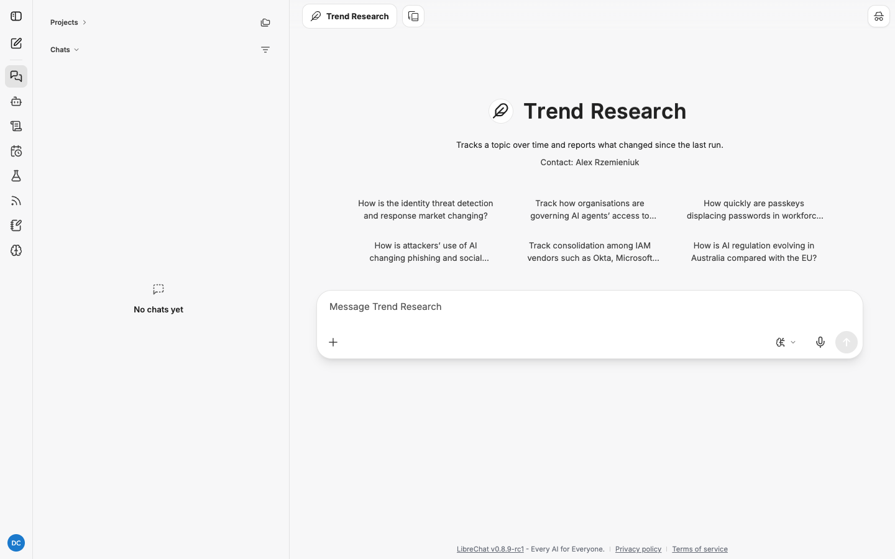

# Trend Research: how to use it

Trend Research tracks a topic over time. Each run reports the current state and, from the
second run on, what changed since the last report. It is built to be scheduled, and it reads
its own earlier reports as sources.

| | |
|---|---|
| Reads | Web search, your feeds, and your previous delivered reports from the same schedule |
| Schedulable | Yes, and that is where it earns its keep |
| Default budget | 30 minutes, 300 steps |
| Prior reports loaded | Up to 3 by default (your administrator can raise it to 20) |
| Direct link | `/c/new?agent_id=agent_research_trends` |

Read [research-agents.md](research-agents.md) first for how jobs run and how to read a report.

## When to use it

- Watching a market: vendor moves, consolidation, pricing shifts.
- Watching a practice: how organisations are adopting a control or a technology.
- Watching a regulatory space across jurisdictions.
- Anything where "what changed since last month?" is the question you keep asking.

For a one-off "what is happening now", use
[Current Events Research](current-events-research.md). For filtering your feeds daily, use
[Daily Digest](daily-digest.md).

## How "what changed" works

When a trend job fires from a schedule, it loads that schedule's most recent delivered
reports (three by default) as prior-report sources. The template then requires a section
comparing against them. On the first run there is nothing to compare, and the report says so
plainly.

The comparison only works across runs of the **same schedule**. A one-off chat with the
Trend Research agent produces a first-run report with no history. If you want tracking,
schedule it.

Prior reports are sources like any other. A sentence such as "the vendor count fell from
seven to five" cites both the earlier report and the new page that shows five.

## Run one, step by step

Run the question by hand once to check the brief and the shape of the report, then schedule
it.

1. Start a new chat, click the model name, hover **My Agents** and choose
   **Trend Research**.

   

2. Click a starter, or type your topic as a standing question and send.
3. Open the **Research** panel to follow it.
4. Read the brief. **Sources** should say no prior reports exist; that is correct for a
   chat run.
5. When the panel says **Delivered**, click **Download the report** in the conversation.
   **What changed since the last report** will say this is the first report.
6. If the brief and report look right, schedule the same prompt (below).

### The six starters

| Starter |
|---|
| How is the identity threat detection and response market changing? |
| Track how organisations are governing AI agents' access to enterprise systems. |
| How quickly are passkeys displacing passwords in workforce identity? |
| How is attackers' use of AI changing phishing and social engineering? |
| Track consolidation among IAM vendors such as Okta, Microsoft Entra, Ping, SailPoint and CyberArk. |
| How is AI regulation evolving in Australia compared with the EU? |

## The report template

```
## Summary
## What changed since the last report   required; compares against prior reports, or says
                                         this is the first report
## Current state
## Signals to watch
```

If a draft leaves out **What changed since the last report**, the heading is added with a
note saying it was missing.

## Worked examples

Illustrative: the shape you get back, not a recorded run. Citation numbers stand for entries
in the report's **Sources** list.

### Example 1: a first run

**You send:**

```
How is the identity threat detection and response market changing? Cover the main vendors,
what capabilities they have added in the past quarter, and how analysts describe the
category. Australian relevance where you can find it.
```

**The brief** lists web search, fetched pages and feed items under Sources, and adds "No
prior reports exist for this topic." Exclusions: vendor marketing claims with no dated
announcement behind them.

**The report:**

```
## What changed since the last report
This is the first report on this topic. There is no earlier report to compare against.

## Current state
### Vendors
- Vendor A added session anomaly detection for SaaS applications on 14 October [2].

## Signals to watch
- Two vendors have announced but not shipped agent identity coverage [5] [6].
```

### Example 2: a scheduled run with history

A monthly schedule with the prompt:

```
Track how organisations are governing AI agents' access to enterprise systems. Cover
standards and frameworks, vendor controls, and published incidents. Note what is new since
the last report.
```

The **first run** says "This is the first report on this topic". The **second run**, a month
later, opens differently:

```
## What changed since the last report
- A standards body published a draft profile for agent identity that was not available at
  the last report [1] [4].
- Vendor B shipped the per-task scoping it had only announced last month [1] [7].
- The incident count in public reporting rose from two to five [1] [9].
```

Source [1] is the previous report; the second citation on each line is the new evidence.
That is the agent proving the change rather than asserting it.

### Example 3: comparing jurisdictions

```
How is AI regulation evolving in Australia compared with the EU? Track legislation,
guidance and enforcement. Give each jurisdiction its own subsection under Current state.
```

The agent honours the subsection request within the template. Over several runs, the "what
changed" section becomes a running log of regulatory movement.

## Scheduling it

Full walkthrough: [scheduling.md](scheduling.md).

1. Open **Scheduled chats** on the rail and click **New schedule**.
2. **Agent**: Trend Research.
3. **Prompt**: the topic as a standing question. Avoid "this week" or "today"; the schedule
   provides the cadence.
4. **Frequency**: Weekly suits fast markets. For fortnightly or monthly, choose **Custom**
   and enter a cron expression, for example `0 7 1 * *` for 7am on the 1st of each month.
5. Click **Create**.

Each run creates a new conversation. Prior reports come from the same schedule's earlier
delivered runs. If you delete the schedule and create a new one, the history starts again.

## Tips

- **Write the prompt as a standing question.** "How is X changing?" not "What happened to X
  this month?"
- **Name the dimensions you want tracked.** Vendors, capabilities, regulation, incidents.
  Consistent dimensions make "what changed" comparable run to run.
- **Do not edit the schedule's prompt often.** Each change shifts what the next run compares
  against.
- **Expect the first run to look like a Current Events report.** That is correct. The value
  arrives on run two.

## Troubleshooting

| Symptom | Cause | Fix |
|---|---|---|
| "This is the first report" on every run | Runs are from different schedules, or earlier runs failed | Check the Research panel for failed runs; keep one schedule per topic |
| "What changed" is empty or vague | Little moved, or the dimensions drifted | Normal in quiet months; keep the prompt stable |
| **Partial report** | Broad topic over 300 steps | Split into two schedules by dimension |
| A change cites the prior report but is marked **[Unverified]** | The agent inferred a change the new evidence does not show | Read both citations before repeating it |
